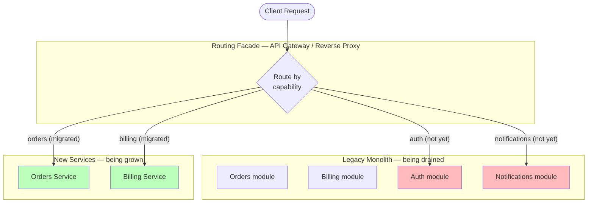

# 🧠 Topic: Strangler Fig Pattern

> [!abstract] Executive Summary (ELI5)
> Strangler Fig is a way to replace an old system without ever taking it offline. Instead of building a brand-new system in a corner and hoping to "flip the switch" one day, you put a router in front of the old system, build *one piece* of the new system, and route just *that piece's* traffic to the new code. Everything else still hits the old system. You repeat — piece by piece — until the old system has nothing left to do, and you turn it off. Named after the strangler fig tree, which seeds in a host tree's canopy, grows its own trunk around the host, and eventually the host dies and only the fig remains.

---

## 🎯 The "Why"
- **Problem Solved:** How do you migrate off a monolith (or any legacy system) without a high-risk "big-bang" cutover — where you freeze features for months, build the replacement, and pray it works on launch day?
- **Alternatives:**
  - **Big-bang rewrite:** build the new system in parallel, cut over in one risky deployment. High failure rate; freezes feature delivery; the new system is built against *guesses* about the old system's behavior.
  - **Branch by abstraction:** wrap the old component behind an interface, swap implementations behind it. Useful for *single-component* swaps but doesn't scale to whole-system migration.
  - **Parallel run:** run old and new side by side, shadow-compare outputs, then cut over. Expensive (double infrastructure); good for correctness verification but not a migration strategy on its own.
- **Trade-offs:** Strangler Fig gives you incremental, reversible, low-risk migration — but you pay for it with a (temporary) **routing facade** sitting in front of two systems, and you must keep the old system alive and maintained until fully drained.

## 💡 Mental Model & Analogy
- **Analogy:** "Imagine renovating a house one room at a time. You don't move out for six months and hope the new house is done — you live in it the whole time. You rebuild the kitchen first; while the kitchen is under construction you cook in a temporary one. Once the new kitchen is done, you demolish the old one. Then the bathroom. Then the bedrooms. Eventually the entire house is new, but you were never homeless." The facade is the front door — every visitor (request) gets routed to whichever room (old or new) currently handles their need.
- **Visual/Diagram:**



> [!tip] The Golden Rule
> **The monolith keeps running throughout the entire migration.** At every step, the system is fully operational and shippable. If the new service turns out to be wrong, you flip the route back. The migration is *incremental and reversible* — that is the whole point.

---

## 🛠️ Core Principles

### The Four-Step Mechanism
1. **Place a routing facade** — an API gateway, reverse proxy, or smart load balancer — in front of the legacy monolith. All client traffic now enters through the facade.
2. **Build one new service** for one extracted capability. The facade routes *just those requests* to the new service; everything else still passes through to the monolith.
3. **Repeat** — capability by capability — building new services and re-routing the facade. The monolith shrinks incrementally.
4. **Decommission the monolith** when it has nothing left to serve. The strangler fig has replaced the host.

### Why This Works — Incremental, Reversible, Observable
- **Incremental:** Each extracted capability is a small, independently deployable change. No freeze on feature delivery — the monolith keeps shipping while services are extracted alongside.
- **Reversible:** If a new service is wrong, flip the route back to the monolith. Low blast radius per step.
- **Observable:** You see real traffic on each new service before committing further. Feedback under load, not under a launch event.

### The "Pre-Cut Seam" Advantage
This is why Strangler Fig pairs so naturally with the **modular monolith** (see [[Monolithic Architecture]]). A modular monolith has its internal boundaries already drawn as *module seams*. Extraction follows existing lines:

- If the monolith's `Orders` module already has a clean interface to the rest of the system, extracting an `Orders Service` means replacing that interface with an HTTP call — a project, not a rewrite.
- If instead you started with services drawn around *hypothetical* boundaries (candidate capabilities, not validated bounded contexts — see [[Identifying Microservices]]), there are no clean lines to follow. Extraction becomes *redrawing boundaries under load*, which is itself a migration, not a refactor.

> [!note] Fowler's framing
> Martin Fowler named the pattern after the strangler fig (*Ficus watkinsiana*), which germinates in the upper branches of a host tree, gradually sends roots down to the ground, and over time surrounds and replaces the host. He introduced it in his 2004 article *"StranglerFigApplication"* as the canonical answer to the question *"how do you migrate off a large legacy system safely?"*

### Synchronous vs Asynchronous Strangling
- **Synchronous extraction** — the facade routes HTTP/gRPC calls to the new service. The service owns its data via a one-time data migration + a synchronization period (often dual-writes or CDC — change data capture).
- **Asynchronous strangling via events** — the monolith publishes domain events; new services subscribe and build their own read models or take over a workflow. This is the bridge between Strangler Fig and [[Event-Driven Architecture]]. It adds the EDA tax (eventual consistency, schema evolution, exactly-once) but enables cleaner decoupling.

---

## 💻 Examples Across Domains

### 1. E-commerce: Extracting the Orders Service from a Sales Monolith
The facade inspects the request path. `/orders/*` goes to the new service; everything else still hits the monolith. Data is migrated via CDC so the new Orders service stays in sync until the cutover.

```typescript
// Facade routing rule (e.g., API Gateway config)
const routes = {
  "/orders/*":     "orders-service.prod",   // EXTRACTED — new service
  "/billing/*":    "monolith.prod",          // not yet extracted
  "/catalog/*":    "monolith.prod",          // not yet extracted
  "/auth/*":       "monolith.prod",          // not yet extracted
  "/notifications/*": "monolith.prod",       // not yet extracted
};
// The monolith keeps serving 4 of 5 capabilities. Shipping continues.
```

```typescript
// The new Orders Service owns its data.
// During the transition, dual-writes or CDC keep it in sync
// with the monolith's old `orders` table until the cutover completes.
class OrdersService {
  constructor(private readonly repo: OrderRepository) {}
  async create(cmd: CreateOrderCmd): Promise<OrderId> {
    return this.repo.insert(cmd); // writes to the NEW orders table
  }
}
```

### 2. Banking: Extracting the Ledger Service from a Core Banking Monolith
High-stakes domain. The facade routes ledger writes to the new service; reconciliation jobs run in parallel against both systems for weeks before the monolith's ledger is drained.

```typescript
// During the parallel-run period, a reconciler verifies both systems agree.
class LedgerReconciler {
  async verify(day: Date): Promise<ReconciliationReport> {
    const legacy  = await this.legacyLedger.sum(day);
    const modern  = await this.ledgerService.sum(day);
    return new ReconciliationReport(legacy, modern); // must match to the cent
  }
}
```

### 3. Task Management: Extracting Notifications as an Async Service
Notifications is a natural first extraction — it's already event-shaped ("when X happens, notify Y"). The monolith publishes `TaskAssigned` events; the new Notifications service consumes them. No synchronous route needed.

```typescript
// The monolith publishes; it no longer sends notifications itself.
class TaskModule { // still inside the monolith
  assign(taskId: TaskId, userId: UserId) {
    this.tasks.assign(taskId, userId);
    this.bus.publish(new TaskAssigned(taskId, userId)); // event, not a direct call
  }
}

// The new Notifications service lives outside the monolith and reacts.
class NotificationsService {
  @EventHandler(TaskAssigned)
  async onAssigned(e: TaskAssigned) {
    const prefs = await this.prefs.get(e.userId);
    await this.channel(prefs).send(`Task ${e.taskId} assigned`);
  }
}
```

---

## 🚦 When to Fire Strangler Fig — The Exit Criteria

Strangler Fig is the *how*, not the *when*. You fire it when one of these criteria is met — and *only* then. Until then, the monolith is the right shape.

| # | Criterion | The signal |
|---|---|---|
| 1 | **Independent scaling need** | A module has a load/throughput profile the rest of the system doesn't share. Extracting lets it scale on its own without overprovisioning the whole monolith. |
| 2 | **Distinct team ownership** | A real Conway unit (see [[Conway's Law]]) has formed around the module — its own team, its own planning cadence. Forcing it onto the monolith's single release train now costs more than it saves. |
| 3 | **Stabilized boundary + different release cadence** | The boundary has survived contact with real usage (validated bounded context — see [[Identifying Microservices]]) and the module legitimately needs to ship faster or slower than the core. |

> [!warning] Don't extract prematurely
> If *none* of the three criteria has fired, extraction is **premature generalization** — you pay the operational and data-coupling tax of a new service for benefits you can't yet collect. YAGNI applies. See the modular monolith's whole-thesis defense in [[04_Easy_Defending_The_Monolith]].

---

## ⚠️ Pitfalls & Anti-patterns
- **Common Mistakes:**
  - **Big-bang cutover disguised as Strangler Fig:** extracting one giant service that handles half the system, then flipping the route. That's a big-bang in a trench coat — you lose the incrementality that makes the pattern safe. Extract *one capability at a time*.
  - **Shared database after extraction:** the new service reads the monolith's tables directly. You've moved the code but not the data — coupling persists. The boundary isn't real until the data is owned independently (often via CDC + dual-write + eventual migration).
  - **Forgetting to drain the monolith:** the new services are built, the routes point at them, but the old monolith code stays "just in case." It accrues maintenance cost for years. Strangler Fig's final step is *decommissioning* the host.
  - **No rollback plan:** if the new service misbehaves, you need to flip the route back *immediately*. The facade must support instant route reversal; if it doesn't, you've built a single point of failure.
  - **Extracting before a boundary stabilizes:** drawing a service around a *candidate capability* (unvalidated hypothesis) means you'll extract, then re-extract when the boundary shifts under load. Validate the boundary first (see [[Identifying Microservices]]).
- **When NOT to use Strangler Fig:**
  - When the legacy system is small enough that a clean rewrite is genuinely cheaper than the facade-and-incremental-routing overhead.
  - When the legacy system's internal boundaries are nonexistent ("big ball of mud") — there are no seams to extract along, and Strangler Fig becomes a slow path to the same rewrite.
  - When you cannot deploy a routing facade in front of the legacy system (e.g., clients call the monolith directly via protocols you can't intercept).

---

## 🔗 Deep Connections
- **Parent Topic:** [[Monolithic Architecture]] — Strangler Fig is the documented extraction path that makes "modular monolith first" a safe strategy rather than a deferred-rewrite gamble.
- **Companion Principles:**
  - **[[Monolithic Architecture]] → MonolithFirst (Fowler)** — you discover boundaries by *running* the monolith; Strangler Fig is what you do once a boundary is discovered and an exit criterion fires.
  - **[[Conway's Law]]** — exit criterion #2 (distinct team ownership) is literally "a Conway unit has formed."
  - **[[Identifying Microservices]]** — candidate capabilities vs. validated bounded contexts; only validated boundaries are safe to extract.
- **Related Exercises:**
  - [[03_Advanced_Strangler_Fig_Extraction]] — the dedicated exercise on this pattern's mechanics (data decoupling, dual-run cutover).
  - [[04_Easy_Defending_The_Monolith]] — the defense exercise where Strangler Fig is the closing argument.
- **Related Patterns:** [[Event-Driven Architecture]] (async strangling via events), Branch by Abstraction (single-component variant), Parallel Run / Shadow Mode (correctness verification).

---

## ❓ Active Recall Questions

> [!faq]- Why is Strangler Fig safer than a big-bang rewrite?
> It is incremental and reversible. Each extracted capability is a small, independently deployable change with instant rollback. The monolith keeps running throughout, so feature delivery never freezes and failures have small blast radius. A big-bang rewrite freezes the system for months and cuts over in one high-risk deployment.

> [!faq]- What are the four steps of the Strangler Fig mechanism?
> (1) Place a routing facade in front of the monolith. (2) Build one new service for one capability and route just those requests to it. (3) Repeat capability by capability. (4) Decommission the monolith when it has nothing left to serve.

> [!faq]- What are the three exit criteria — when do you *fire* Strangler Fig?
> (1) A module has an independent scaling need the rest of the system doesn't share. (2) A distinct team (a Conway unit) has formed around the module. (3) A stabilized boundary demands a different release cadence than the core. Until one fires, extraction is premature generalization (YAGNI).

> [!faq]- Why does Strangler Fig pair naturally with the modular monolith?
> A modular monolith already has its internal boundaries drawn as module seams. Extraction follows existing clean lines — replacing a module's in-process interface with an HTTP call is a project, not a rewrite. Starting with services around hypothetical boundaries means there are no clean lines to extract along.

> [!faq]- What is the most common data-coupling pitfall in Strangler Fig migrations?
> Extracting the code but leaving the new service reading the monolith's database directly. The boundary isn't real until the data is owned independently. The fix is data migration plus a synchronization period (CDC, dual-writes) until the new service owns its own store.

> [!faq]- How can Strangler Fig use event-driven architecture?
> Instead of (or alongside) synchronous route extraction, the monolith publishes domain events and new services subscribe to take over a workflow or build their own read models. This enables cleaner decoupling but adds the EDA tax (eventual consistency, schema evolution, exactly-once) — see [[Event-Driven Architecture]].

---
## 📝 How to use this template effectively
1. **Never Copy-Paste:** If you find yourself copying documentation, stop. Read, close the tab, and write it from memory.
2. **Iterate:** Fill the 'ELI5' and 'Analogy' first. If you can't explain it simply, you don't understand it yet.
3. **The "Why" is King:** Seniority is defined by knowing *when* and *why* to use a tool, not just *how*.
