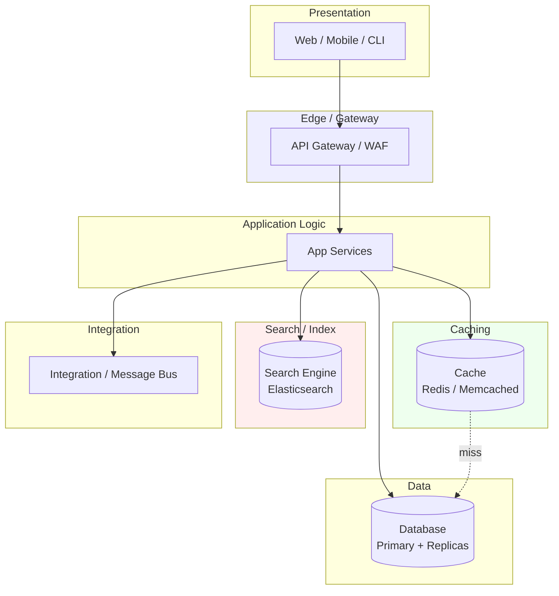

# 🧠 Topic: N-Tier Architecture

> [!abstract] Executive Summary (ELI5)
> N-tier is like a large hospital. There's the reception (presentation), triage (a first processing tier), specialist clinics (application logic), the lab (a dedicated processing tier), and the pharmacy/records vault (data). Each unit specializes and hands off to the next. A big hospital needs all these units because thousands of patients flow through daily with very different needs. A small clinic doesn't — three rooms are plenty. N-tier is the hospital: you add tiers when the scale and complexity genuinely demand them.

---

## 🎯 The "Why"
- **Problem Solved:** How do we structure large, high-scale, or complex systems where three tiers aren't enough — where caching, integration, security, search, or processing each need their own dedicated tier?
- **Alternatives:** [[Three Layered Architecture|Three-tier]] (simpler, fewer moving parts), [[Microservices Architecture|microservices]] (decompose by business capability instead of technical tier), [[Two Layered Architecture|two-tier]] (too simple for most real systems).
- **Trade-offs:** N-tier optimizes for **granular scalability, specialized tiers, and separation of concerns** at the cost of **latency (many hops), operational complexity, and deployment difficulty** that grows with every tier you add.

## 💡 Mental Model & Analogy
- **Analogy:** "N-tier is like an assembly line in a car factory." Raw materials enter, and each station (tier) adds one specialized thing — frame, engine, paint, interior, inspection. Each station can be sped up or duplicated independently. You don't put the engine in at the paint station. More stations mean more specialization and throughput — but also more coordination, more conveyor belts, and more places for a jam. You build a long assembly line because the volume justifies it; a custom coachbuilder wouldn't.
- **Visual/Diagram:**

## 🛠️ Core Principles

### What is an N-Tier Architecture
An **n-tier architecture** generalizes the layered idea to **any number of tiers** (where n > 3). Where [[Three Layered Architecture|three-tier]] fixes presentation, application, and data, n-tier **adds dedicated tiers** for concerns that deserve their own infrastructure: caching, search, integration, security/edge, background processing, and so on.

The question n-tier answers is: *"Which concerns are significant enough to warrant their own independently scalable tier?"* Every tier you add should earn its place by needing to scale, evolve, or be operated separately from the others.

Key characteristics:
- **More than three tiers:** Typically 4–7 in practice; "n" is whatever the system demands.
- **Each tier is a physical (or logical) layer** with its own deployment, scaling, and often its own technology.
- **Specialized tiers:** A cache tier, a search tier, an integration/message tier, an edge/security tier — each does one cross-cutting job.
- **Tier-to-tier communication over the network:** Each hop is a call (HTTP, gRPC, or a broker).
- **Independent scaling per tier:** The search tier can scale without touching the cache tier or the app tier.

### Common Tiers Found in N-Tier Systems

| Tier | Role | Example Technologies |
|------|------|---------------------|
| **Presentation** | UI: web, mobile, desktop | React, Swift, Electron |
| **Edge / Security / Gateway** | TLS termination, WAF, auth, rate limiting | Cloudflare, API Gateway, WAF |
| **Application Logic** | Core business rules / use cases | Spring Boot, Django, .NET |
| **Caching** | Fast in-memory reads | Redis, Memcached, CDN |
| **Search / Index** | Full-text / filtered queries | Elasticsearch, OpenSearch, Solr |
| **Integration / Messaging** | Async communication with other systems | Kafka, RabbitMQ, SQS |
| **Background Processing** | Long-running or scheduled jobs | Celery, batch workers, schedulers |
| **Data** | Persistent storage | PostgreSQL + read replicas, sharded DBs |

> [!note] "Tier" vs "Layer"
> These terms are often used interchangeably, but there's a useful distinction: a **layer** is a *logical* separation in code (presentation layer, data layer); a **tier** is a *physical* separation (presentation runs on server A, data on server B). N-tier emphasizes physically separated, independently deployable units. In practice, three-layer and three-tier are used loosely to mean the same thing.

### When Does Three-Tier Become N-Tier?

You don't start at n-tier — you grow into it. Three-tier becomes n-tier when:

- **A concern needs its own scaling profile.** Search traffic spikes independently of writes → give search its own tier (Elasticsearch cluster).
- **A concern needs its own technology.** Relational DB can't do fast full-text search → add a dedicated search tier.
- **A cross-cutting concern deserves centralization.** Caching, auth, rate limiting → push to an edge/gateway tier so all clients benefit uniformly.
- **Integration complexity grows.** Many external systems to talk to → an integration/messaging tier decouples you from them.
- **Security demands separation.** A DMZ or edge tier isolates the public internet from internal services.

### Pros
- **Granular scalability:** Each tier scales independently to its own load profile — scale search without touching cache or app.
- **Specialized technology per tier:** Use Elasticsearch for search, Redis for cache, Postgres for transactions — the right tool for each job.
- **Strong separation of concerns:** Each tier does one thing, with a clear contract to its neighbors.
- **Independent deployment and evolution:** Update the search tier without redeploying the app tier.
- **Fault isolation per tier:** A cache outage degrades (slower reads) but doesn't crash the app; a search outage doesn't block writes.
- **Flexible security zones:** Edge/DMZ tiers isolate public traffic; internal tiers stay private.
- **Supports very high scale:** N-tier is the structural basis of most large-scale enterprise and internet systems.

### Cons
- **Latency compounds with every hop:** Each tier boundary is a network call plus serialization. Seven tiers can mean six hops — latency and failure points multiply.
- **High operational complexity:** More tiers = more deployments, more monitoring, more on-call coverage, more failure modes to understand.
- **Expensive:** Each tier is its own infrastructure (servers, licenses, replication). Costs scale with tier count.
- **Harder debugging:** A single request may cross 5+ tiers. Without distributed tracing, root-causing is painful.
- **Deployment coordination:** Schema or contract changes can ripple across multiple tiers.
- **Over-engineering risk:** Adding tiers "for completeness" that don't earn their keep — pure indirection and latency.
- **More failure surface:** Every tier is a potential point of failure; every hop a place for timeouts and retries.

### Use Cases (When to Use)
- **Large-scale web applications** with distinct scaling needs per concern (e.g., read-heavy search vs. write-heavy transactions).
- **Enterprise systems** integrating many internal and external services.
- **Systems with specialized workloads** — full-text search, real-time analytics, heavy caching, batch processing.
- **High-security environments** needing DMZ/edge separation.
- **Systems where three-tier's database has become the bottleneck** and concerns must be split out (cache tier, search tier, CQRS read models).

### When NOT to Use
- **Small or medium applications** where [[Three Layered Architecture|three-tier]] handles the load — n-tier adds unjustified complexity.
- **Early-stage products** where you don't yet know which concerns need their own tier.
- **Teams without mature DevOps** — operating many tiers demands strong CI/CD, monitoring, and automation.
- **When latency is critical** and every hop matters — fewer tiers (or colocation) may be better.

### Real-World Examples
- **E-commerce platforms** (Amazon-scale): edge CDN → WAF/gateway → web app → catalog/search (Elasticsearch) → cart/order services → inventory → payments → DB clusters — many specialized tiers.
- **Banking systems:** presentation → API gateway → application services → fraud-detection tier → integration tier (core banking, external networks) → encrypted data tier with replicas. Heavy tier separation for security and compliance.
- **Large SaaS (e.g., Salesforce):** multi-tenant presentation → gateway → app tier → metadata/cache tier → search tier → sharded database cluster.

## 🏗️ Performance and Scalability Impacts

### Performance
- **Latency grows with tier count:** Every tier boundary adds a network hop and serialization cost. A request crossing 5 tiers pays ~5× the per-hop latency of a 1-hop call. This is the fundamental performance tension in n-tier.
- **But: specialized tiers can be much faster at their job.** A cache tier answers reads in microseconds; a search tier runs full-text queries an order of magnitude faster than a relational DB. Net latency can *drop* for the right workload even though hop count rose.
- **Parallelism across tiers:** Independent tiers can process in parallel (e.g., the app tier fires off a search query and a cache lookup concurrently), offsetting some hop cost.
- **Cache effectiveness multiplies:** Dedicated cache and CDN tiers absorb the majority of reads, so the data tier sees far less traffic — the system feels faster overall.

### Scalability
- **Per-tier horizontal scaling:** The headline benefit. Scale only the tier under load — e.g., add search nodes during a catalog-browsing spike without touching the write path or the DB.
- **Independent scaling profiles:** Write-heavy, read-heavy, CPU-heavy, and memory-heavy tiers each scale to their own curve.
- **Data tier relief:** Caching and search tiers offload work from the database, pushing the DB ceiling much higher than in three-tier.
- **Polyglot persistence:** Different data tiers for different needs (Postgres for transactions, Elasticsearch for search, Redis for cache, S3 for blobs).
- **The cost of more failure surfaces:** Every tier that can fail needs replicas, failover, and circuit breakers — scalability isn't free.

## 🛡️ Solutions to Mitigate Performance and Scalability Issues

| Problem | Mitigation |
|---------|------------|
| **Latency from many hops** | **Colocate** chatty tiers in the same data center/zone; use **gRPC** (HTTP/2 multiplexing, binary) for internal calls; **batch** and **aggregate** requests to reduce round-trips; use **asynchronous/event-driven** handoffs for non-critical paths. |
| **Repeated reads hitting the data tier** | Add a **caching tier** (Redis/Memcached) and a **CDN** for static/edge content; use **read-through/write-through** cache patterns. |
| **Slow full-text or filtered queries** | Offload to a dedicated **search tier** (Elasticsearch/OpenSearch) with its own index, scaled independently. |
| **DB write bottleneck** | **Shard/partition** the database; use **read replicas** for reads; push non-critical writes to an **async queue** (write-behind). |
| **Tier failure cascading** | **Circuit breakers** (stop calling a failing tier), **timeouts**, **retries with backoff**, and **graceful degradation** (serve stale cache when the data tier is down). |
| **Cross-tier debugging** | **Distributed tracing** (Jaeger, Zipkin) with **correlation IDs** propagated across every tier; centralized structured logging. |
| **Deployment risk across many tiers** | **Backward-compatible contracts**, independent per-tier deployment pipelines, **feature flags**, and **canary releases**. |
| **Connection pressure on the DB** | **Connection pooling** (PgBouncer, HikariCP) so tiers share a bounded pool; **read replicas** to spread reads. |
| **Operational complexity** | **Infrastructure as code**, **containerization + orchestration** (Kubernetes), and **centralized observability** (metrics, logging, tracing). |
| **Unbounded tier growth (over-engineering)** | Apply a **cost/benefit gate** to every new tier: does it earn its own scaling, tech, or security profile? If not, keep it inside an existing tier. |

> [!tip] The n-tier balancing act
> Every tier you add trades **latency and operational complexity** for **specialization and independent scaling**. The discipline is to add a tier only when a concern genuinely needs its own scaling profile, technology, or security zone — never "for completeness." A tier that doesn't earn its keep is pure overhead.

## ⚠️ Pitfalls & Anti-patterns
- **Tier explosion:** Adding tiers because "more layers = better." Each tier must earn its place with an independent scaling, tech, or security justification. Indirection without purpose is just latency.
- **Chatty inter-tier calls:** Many small calls per user action across multiple tiers — latency compounds. Batch and aggregate.
- **Synchronous chains across many tiers:** A request blocking through 5 tiers serially. Use async/event-driven handoffs for non-critical steps to decouple.
- **No circuit breakers:** One slow tier cascades and brings down the whole request path. Every cross-tier call needs timeouts and circuit breakers.
- **No distributed tracing:** With 5+ tiers, debugging without tracing is guesswork. Correlation IDs are mandatory.
- **Shared database across logical tiers:** If multiple "tiers" all hit the same DB tables, they're not really decoupled — you've built a distributed monolith.
- **Treating tiers as layers carelessly:** Mixing the physical-tier and logical-layer distinctions leads to confused dependencies and deployments.
- **Premature n-tier:** Starting at n-tier before you know which concerns need their own tier. Start at three-tier, add tiers when a concern demands it.

## 🔗 Deep Connections
- **Parent Topic:** [[Layered Architecture]]
- **Related Concepts:** [[Two Layered Architecture]], [[Three Layered Architecture]], [[Microservices Architecture]], [[Client Server Model]], [[Caching]], [[Load Balancing]], [[API Gateways]], [[Event-Driven Architecture]]
- **Siblings:** N-tier is the largest member of the multi-layered family — it extends [[Three Layered Architecture|three-tier]] with specialized tiers. It overlaps with [[Microservices Architecture|microservices]] but decomposes by *technical concern* (cache, search, data) rather than by *business capability*.
- **Prerequisites:** Solid understanding of three-tier architecture, caching, load balancing, and distributed systems.

## ❓ Active Recall Questions
> [!faq]- What is an n-tier architecture, and how does it differ from three-tier?
> A generalization of layered architecture to **any number of tiers** (n > 3). Where three-tier fixes presentation, application, and data, n-tier adds dedicated tiers for concerns that need their own infrastructure: caching, search, integration, edge/security, background processing. You add a tier when a concern deserves its own scaling profile, technology, or security zone.

> [!faq]- What are the main advantages of n-tier?
> Granular per-tier scalability (scale only the hot tier), specialized technology per concern (Elasticsearch for search, Redis for cache, Postgres for transactions), strong separation of concerns, independent deployment/evolution per tier, fault isolation (a cache outage degrades rather than crashes), flexible security zones, and the ability to support very high scale.

> [!faq]- What are the main disadvantages of n-tier?
> Latency compounds with every hop (6 hops across 7 tiers), high operational complexity (more deployments, monitoring, on-call), expense (each tier is its own infrastructure), harder debugging without distributed tracing, deployment coordination across tiers, over-engineering risk, and a larger failure surface — every tier is a potential point of failure.

> [!faq]- When does three-tier become n-tier?
> When a concern needs its own scaling profile (search spikes independently of writes), needs its own technology (relational DB can't do fast full-text search), is cross-cutting enough to centralize (caching, auth, rate limiting at an edge tier), involves complex integration (many external systems → a messaging tier), or demands security separation (DMZ/edge tier). You grow into n-tier — you don't start there.

> [!faq]- How does n-tier affect performance, and how do you mitigate the latency?
> Every tier adds a network hop and serialization, so latency grows with tier count. Mitigate by: colocating chatty tiers in the same data center, using gRPC (HTTP/2, binary) for internal calls, batching/aggregating requests, using async/event-driven handoffs for non-critical paths, and caching aggressively so most reads never reach the data tier. Specialized tiers (cache, search) can actually *reduce* net latency for the right workload.

> [!faq]- Why does n-tier scale better than three-tier, and what's the eventual ceiling?
> Because each tier scales independently to its own load profile — you add search nodes during a browse spike without touching the write path. Caching and search tiers offload the database, pushing the DB ceiling far higher than in three-tier. The ceiling eventually becomes the write path on the primary DB (mitigated by sharding) or the operational complexity of running many tiers.

> [!faq]- How do you prevent one tier's failure from cascading across the system?
> Use **circuit breakers** (stop calling a failing tier), **timeouts** (don't block forever), **retries with backoff**, and **graceful degradation** (serve stale cache when the data tier is down). Every cross-tier call should assume the callee can fail. Without these, one slow tier cascades and brings down the entire request path.

> [!faq]- What's the over-engineering risk with n-tier, and how do you avoid it?
> Adding tiers "for completeness" that don't earn their keep — pure indirection and latency. Avoid it with a **cost/benefit gate**: a new tier must justify itself with an independent scaling profile, a distinct technology need, or a security requirement. If it doesn't, keep the concern inside an existing tier. Start at three-tier and add tiers only when a concern demands it.

> [!faq]- How does n-tier differ from microservices?
> N-tier decomposes by **technical concern** (presentation, cache, search, data), while microservices decompose by **business capability** (orders, payments, catalog). They often coexist: a microservices system may use an n-tier structure internally (each service has cache, app, data layers). N-tier is about *infrastructure tiers*; microservices are about *service boundaries*.

> [!faq]- Why is distributed tracing essential in n-tier systems?
> Because a single user request may cross 5+ tiers, and without tracing (Jaeger, Zipkin) plus correlation IDs propagated across every hop, root-causing a slow or failed request is guesswork. Tracing lets you see the full path, where time was spent, and which tier failed. It's mandatory, not optional, at n-tier scale.

---

*Last updated: 2026-07-11*
