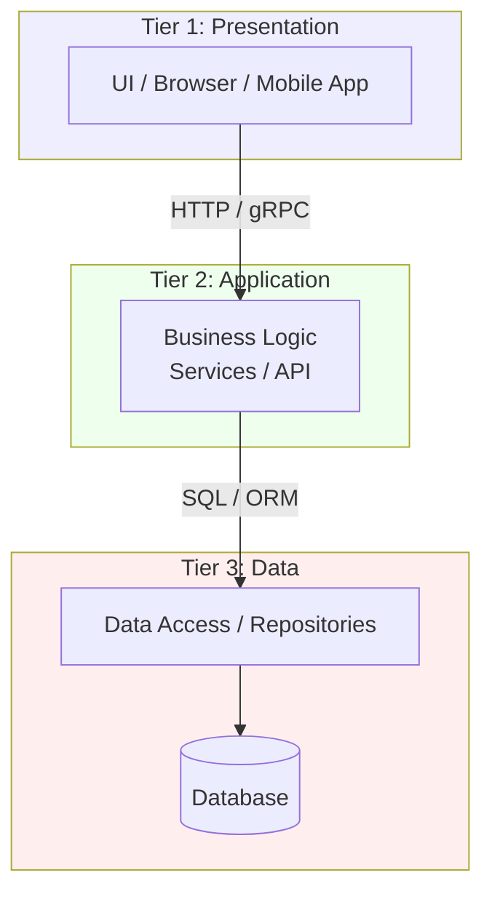

# 🧠 Topic: Three-Layered (Three-Tier) Architecture

> [!abstract] Executive Summary (ELI5)
> A three-layered architecture is like a restaurant. The dining area (presentation) is where customers sit and order. The kitchen (application/business logic) prepares the food according to recipes. The pantry (data) stores the ingredients. Each part has a clear job, and they talk only to the one next to them. If the pantry changes suppliers, the kitchen adjusts — the customers never notice. You can also expand the kitchen (hire more cooks) without rebuilding the dining room.

---

## 🎯 The "Why"
- **Problem Solved:** How do we separate the user interface, the business rules, and the data so that each can evolve and scale independently?
- **Alternatives:** [[Two Layered Architecture|Two-tier]] (simpler but couples client and DB), [[N Tier Architecture|n-tier]] (more tiers for larger scale), a single monolithic process with no layering.
- **Trade-offs:** Three-tier optimizes for **separation of concerns, reuse, and independent scalability** of logic vs. data, at the cost of **more moving parts, network hops, and deployment complexity** than two-tier.

## 💡 Mental Model & Analogy
- **Analogy:** "Three-tier is like a restaurant." Customers (presentation) sit in the dining area and order from a menu. The waiter takes orders to the kitchen (application logic), which prepares each dish using recipes. The kitchen fetches ingredients from the pantry (data). Each role has one job and talks only to its neighbor. You can hire more cooks (scale the logic tier) without touching the dining room.
- **Visual/Diagram:**

## 🛠️ Core Principles

### What is a Three-Layered Architecture
A **three-layered (three-tier) architecture** splits an application into three distinct tiers, each with a single responsibility and deployed (ideally) on its own infrastructure:

1. **Presentation tier (client)** — the user interface. A web frontend, mobile app, or desktop client. Renders data and captures user input. Contains **no business logic**.
2. **Application tier (business logic)** — the "middle tier." Hosts the business rules, use-case orchestration, and workflows. This is the brain of the system. Exposes an API (REST, gRPC) that the presentation tier calls.
3. **Data tier** — the database (and data-access code) that stores and retrieves information. The application tier is the **only** layer that talks to the data tier; the presentation tier never touches the database directly.

The defining advance over [[Two Layered Architecture|two-tier]] is the **middle application tier**: business logic is centralized, reusable, and independently scalable, and the database is hidden behind it.

Key characteristics:
- **Centralized business logic:** The application tier is the single home for rules — shared by all clients.
- **Clear trust boundary:** Clients talk to the application tier's API, never to the DB. DB credentials stay server-side.
- **Independent scalability:** You can scale the application tier (add more app servers) without touching the database, and vice versa.
- **Thin clients:** The presentation tier is a thin UI that calls the API; it holds no business logic or DB access.
- **Physical separation (often):** Each tier commonly runs on its own servers/containers, though three-tier can also be logical layers in one process.

### Common Forms

| Form | Description | Example |
|------|-------------|---------|
| **Web app (browser + app server + DB)** | The dominant modern three-tier form | React frontend + Spring Boot API + Postgres |
| **Mobile app + API + DB** | Mobile as the thin presentation tier | iOS app + Node.js API + MySQL |
| **Desktop client + API + DB** | Desktop UI calling a backend API | Electron app + .NET API + SQL Server |

### Pros
- **Clean separation of concerns:** Each tier has one job; presentation, logic, and data never bleed together.
- **Reusable business logic:** The application tier serves all clients (web, mobile, other services) through one API. No more re-implementing rules per client.
- **Independent scalability:** Scale the application tier horizontally (more app servers) without touching the database. Scale the data tier separately (read replicas, bigger DB).
- **Security boundary:** DB credentials and direct DB access live only on the application tier. Clients never see the database — a clear, defensible trust boundary.
- **Easier updates:** Change business logic in one place (the application tier) and all clients immediately benefit. No fat-client redistribution.
- **Tech-stack flexibility per tier:** The frontend can be React, the API Java, the DB Postgres — each chosen for its job.
- **Parallel team work:** Frontend, backend, and DB teams can work on their tiers in parallel against a stable API contract.
- **Testability:** Each tier can be tested independently (mock the API when testing the UI; mock the DB when testing the logic).

### Cons
- **More moving parts:** Three deployable tiers instead of two — more infrastructure to configure, monitor, and operate.
- **Network hops add latency:** A request now crosses Presentation → Application → Data, adding two network hops (and serialization) compared to two-tier's direct connection.
- **Deployment complexity:** Coordinating releases across three tiers (or at least API + DB schema changes) requires care and versioning.
- **More expensive to run:** Separate servers/containers for each tier cost more than a single two-tier setup.
- **Distributed debugging:** A bug can live in any tier; tracing a request across all three requires logging and correlation IDs.
- **Over-engineering for simple apps:** A small CRUD tool doesn't need a full three-tier stack — it adds ceremony without payoff.
- **API versioning burden:** As the application tier evolves, you must keep the API backward-compatible with existing clients.

### Use Cases (When to Use)
- **Web and mobile applications** of almost any size — three-tier is the default modern structure.
- **Multi-client products** where the same logic must serve a web app, a mobile app, and possibly other services.
- **Any application that may scale** beyond a handful of users.
- **Systems where security matters** — hiding the DB behind an application tier is essential.
- **Team-based development** where frontend and backend engineers work in parallel.

### When NOT to Use
- **Tiny internal tools** with one client and few users — [[Two Layered Architecture|two-tier]] is simpler and sufficient.
- **Prototypes** where speed of assembly trumps structure (but be ready to refactor).
- **Highly distributed, large-scale systems** needing independent scaling of many components — [[N Tier Architecture|n-tier]] or [[Microservices Architecture|microservices]] fit better.

### Real-World Examples
- **Modern web apps:** React/Angular frontend (presentation) + Spring Boot/Django/Express API (application) + PostgreSQL/MySQL (data).
- **SaaS products:** Browser UI + REST API + database — the canonical SaaS stack.
- **Mobile backends:** iOS/Android app + API gateway/app server + database.
- **Most enterprise web applications** built since the mid-2000s.

## 🏗️ Performance and Scalability Impacts

### Performance
- **Added latency from network hops:** Each tier boundary is a network call (plus serialization/deserialization). A request crosses Presentation → Application → Data and back — two hops that don't exist in two-tier.
- **Serialization overhead:** Data must be marshalled (JSON, Protobuf) at each boundary, adding CPU cost and latency.
- **But: centralized caching pays off:** Because logic is centralized in the application tier, you can cache once and benefit all clients — far more effective than per-client caching in two-tier.
- **Connection pooling shines here:** The application tier holds a pool of DB connections shared across all requests, instead of each client holding one (the two-tier problem).

### Scalability
- **Horizontal scaling of the application tier:** This is three-tier's superpower. Add more app servers behind a [[Load Balancing|load balancer]] and you scale business-logic throughput independently of the database.
- **Stateless app tier scales best:** If the application tier is stateless (no in-memory sessions), any app server can handle any request — round-robin load balancing works perfectly. Session state, if needed, goes to an external store (Redis).
- **Data tier scales separately:** Reads scale via read replicas; writes are capped by the primary DB (the eventual reason systems move to n-tier or microservices).
- **Database is still the long-term ceiling:** Three-tier delays but doesn't remove the database bottleneck. Under heavy write load, the single primary DB still becomes the limit — mitigated by caching, replicas, and eventually sharding.

## 🛡️ Solutions to Mitigate Performance and Scalability Issues

| Problem | Mitigation |
|---------|------------|
| **Network hop latency between tiers** | **Colocate** tiers in the same data center / VPC; use **gRPC** (HTTP/2 + binary) for faster inter-tier calls; **batch** requests to reduce round-trips. |
| **Repeated identical reads hitting the DB** | **Caching** at the application tier (Redis/Memcached) and a **CDN** for static presentation assets. Cache once, benefit all clients. |
| **DB connection pressure** | **Connection pooling** in the app tier (HikariCP, PgBouncer) so thousands of requests share hundreds of connections. |
| **Read-heavy load** | **Read replicas** — direct reads to replicas, writes to the primary. |
| **Stateless scaling** | Keep the app tier **stateless**; move session state to **Redis** or a JWT so any app server can serve any request. |
| **Write bottleneck on the primary DB** | **Sharding / partitioning** by tenant or region; move heavy writes to an async queue (write-behind) for non-critical paths. |
| **Serialization overhead** | Use **binary protocols** (gRPC/Protobuf) instead of JSON for internal tier-to-tier calls. |
| **Deployment risk across tiers** | **Backward-compatible API versioning**; deploy presentation and application tiers independently; use **feature flags** for risky changes. |

> [!tip] The key shift from two-tier
> Three-tier's biggest scalability win is that the **application tier can scale horizontally** and **cache centrally**, while the database is shielded behind a connection pool. This is why three-tier scales to thousands of users where two-tier tops out at hundreds.

## ⚠️ Pitfalls & Anti-patterns
- **Presentation tier bypassing the application tier** (e.g., the frontend querying the DB directly): re-creates two-tier's coupling and security holes. Never let the client touch the data tier.
- **Anemic application tier:** The middle tier just forwards calls to the DB and back (a pass-through), adding latency without logic. Give it real responsibility or it's dead weight.
- **Stateful app servers:** Storing sessions in app-server memory breaks horizontal scaling (forces sticky sessions). Keep the app tier stateless; externalize state.
- **Leaky ORM entities crossing tiers:** Returning ORM/DB entity objects directly to the presentation tier leaks DB schema details up. Use DTOs at the boundary.
- **Chatty tier-to-tier calls:** Many small API calls per screen. Batch or aggregate to reduce round-trips.
- **No caching strategy:** Every read hits the DB. Add at least application-tier caching for hot data.
- **Over-engineering a simple app:** Three-tier for a 5-user internal tool is ceremony without payoff.

## 🔗 Deep Connections
- **Parent Topic:** [[Layered Architecture]]
- **Related Concepts:** [[Two Layered Architecture]], [[N Tier Architecture]], [[Client Server Model]], [[Caching]], [[Load Balancing]], [[API Gateways]]
- **Siblings:** Three-tier is the middle member of the multi-layered family — it adds a logic tier to [[Two Layered Architecture|two-tier]] and is extended by [[N Tier Architecture|n-tier]] when more scale or separation is needed.
- **Prerequisites:** Basic understanding of clients, servers, databases, and APIs.

## ❓ Active Recall Questions
> [!faq]- What is a three-layered (three-tier) architecture?
> An application split into three tiers: **presentation** (UI, thin client), **application** (business logic / API, the middle tier), and **data** (database). The presentation tier calls the application tier's API; only the application tier talks to the data tier. The key advance over two-tier is the centralized, independently scalable middle logic tier.

> [!faq]- What are the main advantages of three-tier over two-tier?
> Centralized, reusable business logic (one API serves all clients), independent scalability (scale the app tier horizontally without touching the DB), a clear security boundary (clients never touch the DB), easier updates (change logic in one place), tech-stack flexibility per tier, parallel team work, and independent testability of each tier.

> [!faq]- What are the main disadvantages of three-tier?
> More moving parts (three deployable tiers), network hops adding latency (Presentation → Application → Data), deployment complexity across tiers, higher infrastructure cost, distributed debugging (a bug can be in any tier), API versioning burden, and over-engineering for simple apps.

> [!faq]- Why does three-tier scale better than two-tier?
> Because the application tier can scale **horizontally** (add more app servers behind a load balancer) independently of the database, and business logic is centralized so caching is effective for all clients. Connection pooling in the app tier means thousands of requests share hundreds of DB connections, instead of each client holding one. The DB is still the long-term ceiling, but three-tier delays that wall significantly.

> [!faq]- How does keeping the application tier stateless improve scalability?
> A stateless app server can handle any request from any client — so a load balancer can distribute requests freely (round-robin) and you can add or remove app servers at will. If sessions live in app-server memory, you're forced into sticky sessions, which unbalance load and block elastic scaling. Externalize session state to Redis or use JWTs.

> [!faq]- How would you mitigate the latency added by tier-to-tier network hops?
> Colocate tiers in the same data center/VPC (low network latency), use fast binary protocols like gRPC/Protobuf for internal calls, batch requests to reduce round-trips, and cache hot data at the application tier so many reads never reach the database.

> [!faq]- When would you choose three-tier, and when would you choose something else?
> Choose three-tier for virtually any web/mobile application, multi-client products, anything that may scale, and anything security-sensitive. Choose two-tier for tiny internal single-client tools. Choose n-tier or microservices when you need to independently scale many components or organize around large teams.

> [!faq]- Why is letting the presentation tier talk directly to the database an anti-pattern?
> It re-creates two-tier's coupling and security holes: the client learns the DB schema, holds DB credentials, and bypasses the centralized business logic. It breaks the trust boundary, prevents logic reuse, and makes schema changes break clients. The presentation tier must always go through the application tier's API.

---

*Last updated: 2026-07-11*
