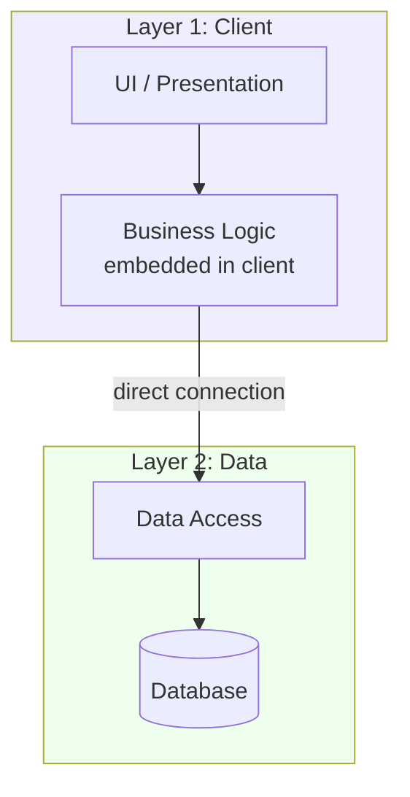

# 🧠 Topic: Two-Layered (Two-Tier) Architecture

> [!abstract] Executive Summary (ELI5)
> A two-layered architecture is like a customer dealing directly with a shop's stockroom. The customer (client layer) walks in, asks for an item, and the stockroom (data layer) hands it over — no shop assistant in the middle. It's fast and simple when there are few customers, but the stockroom gets overwhelmed if everyone barges in at once, and the customer has to know exactly how the stockroom is organized.

---

## 🎯 The "Why"
- **Problem Solved:** What is the simplest way to split an application so that the user interface is separated from the data it works with?
- **Alternatives:** [[Three Layered Architecture|Three-tier]] (adds a middle application/logic layer), [[N Tier Architecture|n-tier]] (adds more tiers for scale), single-tier (everything in one process — no separation at all).
- **Trade-offs:** The two-layered style optimizes for **simplicity and directness** at the cost of **reusability, security, and scalability**. See [[Layered Architecture]] for the general layered-style trade-offs.

## 💡 Mental Model & Analogy
- **Analogy:** "Two-tier is like a customer and a warehouse." The customer (client) browses a catalog and pulls items directly off the shelves. There's no salesperson or front desk — you go straight to the warehouse. Efficient for one customer; chaotic when 500 show up at once, and the customer sees exactly how the warehouse is laid out.
- **Visual/Diagram:**

## 🛠️ Core Principles

### What is a Two-Layered Architecture
A **two-layered (two-tier) architecture** splits an application into exactly two layers:

1. **Client layer** — holds the user interface **and** most or all of the business logic. This is often a "fat client" / "thick client" desktop application.
2. **Data layer** — a database server (and sometimes a thin data-access component) that stores and serves data.

The client opens a **direct connection** to the database. There is no intermediate application server. The client is responsible for presentation *and* the business rules; the database is responsible for storage and (often) some stored procedures and queries.

This was the dominant architecture for business applications in the 1990s — classic client/server tools like Visual Basic, Delphi, and PowerBuilder desktop apps talking directly to a SQL Server or Oracle database.

Key characteristics:
- **Fat client:** Business logic lives in the client application.
- **Direct client-to-database connection:** No middle tier; the client speaks SQL (or a DB driver protocol) straight to the DBMS.
- **Stateful sessions:** The client typically holds an open database connection and session state.
- **Two deployable units:** The client app (installed on each user's machine) and the database server.

### Common Forms

| Form | Description | Example |
|------|-------------|---------|
| **Fat client + DB** | All UI and logic in the desktop client; direct DB connection | VB6 + SQL Server app |
| **Thin client + DB** | Browser UI, but server-side code still talks directly to the DB with no logic tier | Early PHP/Classic ASP pages with inline SQL |

> [!warning] The "thin client" trap
> A web app that puts SQL queries directly in its page templates is technically two-tier — and it's a maintenance and security nightmare (SQL injection, tangled logic, no reuse). Two-tier web apps are generally an anti-pattern today.

### Pros
- **Simplest layered structure:** Only two layers — easy to understand, build, and reason about.
- **Low latency for few users:** Direct client-to-DB connection with no middle hop.
- **Few moving parts:** No application server to deploy, configure, or monitor.
- **Fast to develop (small scale):** Great for internal tools, prototypes, and small-team dashboards.
- **Cheap to run:** One database server and client installs — minimal infrastructure.
- **Leverages DB capabilities:** Stored procedures and queries put processing close to the data.

### Cons
- **Tight coupling between client and database:** The client knows the DB schema and dialect. Changing the schema or swapping the database breaks every client.
- **Fat client / hard to update:** Business logic embedded in the client means every fix requires redistributing and reinstalling the client app on every user's machine.
- **Security exposure:** The client holds DB connection credentials and direct DB access. A compromised client compromises the whole database. No central trust boundary.
- **No reuse of business logic:** Logic embedded in the client can't be shared with other clients (a web portal, a mobile app, another service). Each client reimplements it.
- **Poor scalability:** Every client holds a direct DB connection. Database connection licenses and server capacity are the hard ceiling — typically a few hundred concurrent users at most.
- **No platform independence:** The client is tied to a specific OS and often a specific DB driver.
- **Data integrity risk:** With logic in many clients, different clients can implement rules differently, leading to inconsistent data.
- **Maintenance pain:** Schema changes, DB migrations, and logic fixes ripple across all installed clients.

### Use Cases (When to Use)
- **Internal desktop tools** with a small, known number of users (e.g., a 10-person back-office tool).
- **Prototypes and proofs of concept** where speed of development matters more than scalability.
- **Legacy systems** built before the three-tier norm — maintained, not newly chosen.
- **Single-user or low-concurrency applications** (e.g., a local data-entry app for one workstation).

### When NOT to Use
- **Any web or mobile product** with many users — use at least [[Three Layered Architecture|three-tier]].
- **When business logic must be shared** across multiple clients or services.
- **When security matters** — exposing direct DB access to clients is a serious risk.
- **When you expect to scale** beyond a few hundred concurrent users.

### Real-World Examples
- **Classic client/server ERP and CRM modules** (1990s) — desktop clients talking to a central SQL Server/Oracle DB.
- **Microsoft Access applications** — the .accdb frontend with linked tables is the canonical two-tier desktop app.
- **Legacy point-of-sale systems** — a register client connected directly to a store database.
- **Small business inventory tools** — a desktop app shared by a handful of staff.

## 🏗️ Performance and Scalability Impacts

### Performance
- **Per-request latency is low** for a small number of users — the client talks directly to the DB with no middle hop.
- **Performance degrades fast under load:** each client holds a dedicated DB connection; as connections grow, the database spends more time managing connections and locks than executing queries.
- **Network chattiness:** fat clients often issue many small queries per screen, each round-trip adding latency.
- **No central place to cache:** each client caches independently (or not at all), so repeated queries hit the database repeatedly.

### Scalability
- **Connection-limited scaling:** the database server has a hard ceiling on concurrent connections (hundreds, not thousands). This is the dominant bottleneck.
- **Vertical scaling only, practically:** you make the database server bigger; horizontal scaling is hard because the DB is a shared, stateful resource.
- **Read scaling is possible** via read replicas, but write scaling is capped by the single primary DB.
- **No independent scaling of logic vs. data:** because logic and data are intertwined, you can't scale the business-logic tier separately — it lives in the clients.

## 🛡️ Solutions to Mitigate Performance and Scalability Issues

| Problem | Mitigation |
|---------|------------|
| **Connection exhaustion** | Introduce a **connection pool** so clients share a bounded set of DB connections rather than each holding one. |
| **Repeated identical queries hitting the DB** | Add a **caching layer** (e.g., Redis) or enable DB-level query caching to absorb repeated reads. |
| **Network chattiness (many round-trips)** | **Batch queries** and use **stored procedures** to move processing close to the data and reduce round-trips. |
| **Write/read imbalance** | Add **read replicas** to scale reads; keep writes on the primary. |
| **Fat-client update pain** | Move shared logic into **stored procedures** on the DB (centralizes it) — or, better, **migrate to three-tier**. |
| **Scaling ceiling** | **Partition (shard) the database** by tenant/region to spread load across multiple DB servers. |
| **Lock contention under load** | Keep transactions **short**, use **optimistic concurrency**, and prefer **row-level over table-level locks**. |

> [!tip] The honest mitigation
> The most effective mitigation for two-tier's limits is to **evolve toward three-tier**: extract the business logic into a middle application layer. This unlocks connection pooling, centralized caching, independent scaling, and a security boundary — solving most of two-tier's problems at once.

## ⚠️ Pitfalls & Anti-patterns
- **Embedding SQL in the client UI code:** Tangles presentation with data access and guarantees SQL injection risk. Use parameterized queries at minimum.
- **Storing DB credentials in the client:** A reverse-engineered client hands over the keys to the database. Never do this for internet-facing apps.
- **Holding transactions open across user "think time":** Long-lived transactions hold locks and exhaust connections. Keep transactions short.
- **Skipping the "migrate to three-tier" step:** When you hit the scalability wall, don't add more band-aids — extract a logic tier.
- **Assuming two-tier scales:** It doesn't, past a few hundred users. Plan the exit early.

## 🔗 Deep Connections
- **Parent Topic:** [[Layered Architecture]]
- **Related Concepts:** [[Three Layered Architecture]], [[N Tier Architecture]], [[Client Server Model]], [[Caching]], [[Load Balancing]]
- **Siblings:** The two-tier is the simplest member of the multi-layered family. It evolves into [[Three Layered Architecture|three-tier]] when a middle logic tier is extracted.
- **Prerequisites:** Basic understanding of clients, servers, and databases.

## ❓ Active Recall Questions
> [!faq]- What is a two-layered (two-tier) architecture?
> An application split into two layers: a **client layer** (holding the UI and most business logic — a "fat client") and a **data layer** (the database server). The client connects directly to the database; there is no middle application tier. It was the dominant style for 1990s desktop business apps.

> [!faq]- What are the main advantages of two-tier?
> Simplicity (only two layers), low latency for few users (direct client-to-DB connection), few moving parts (no app server), fast initial development, low infrastructure cost, and the ability to leverage stored procedures close to the data.

> [!faq]- What are the main disadvantages of two-tier?
> Tight client-to-database coupling, hard-to-update fat clients, security exposure (clients hold DB credentials and direct access), no reuse of business logic across clients, poor scalability (connection-limited), no platform independence, and maintenance pain as schemas and logic change.

> [!faq]- Why does two-tier scale poorly?
> Because every client holds a direct database connection, and the DB server has a hard ceiling on concurrent connections (hundreds, not thousands). The database becomes the bottleneck — it's a shared, stateful resource that's hard to scale horizontally. There's also no way to scale the logic tier independently because it's embedded in the clients.

> [!faq]- How would you mitigate two-tier's performance and scalability limits?
> Short term: connection pooling, caching, batch queries/stored procedures, read replicas, and database sharding. Long term: **evolve toward three-tier** by extracting business logic into a middle application layer — this unlocks centralized pooling, caching, independent scaling, and a security boundary, solving most of two-tier's limits at once.

> [!faq]- When would you still choose two-tier today?
> For internal desktop tools with a small, known number of users, prototypes and proofs of concept, single-user/low-concurrency data-entry apps, or maintaining a legacy system. Avoid it for any web/mobile product, anything needing shared logic, anything security-sensitive, or anything expected to scale beyond a few hundred concurrent users.

> [!faq]- Why is a web app with inline SQL considered two-tier, and why is it an anti-pattern?
> The page template (client) talks directly to the database with no logic tier in between — that's the two-tier shape. It's an anti-pattern because it tangles presentation with data access, invites SQL injection, prevents logic reuse, and couples every page to the DB schema. Modern web apps need at least a three-tier structure.

---

*Last updated: 2026-07-11*
