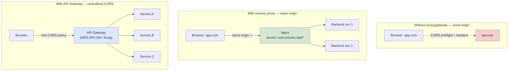

# 🧠 Topic: Alternatives to CORS (Reverse Proxy & API Gateway)

> [!abstract] Executive Summary (ELI5)
> You can sidestep CORS entirely by making sure the browser never makes a *cross-origin* request in the first place. A **reverse proxy** (Nginx, Caddy, Traefik) serves both the SPA and the API under the same origin — `app.com` serves the HTML *and* proxies `/api/*` to the backend. Since the browser sees one origin, SOP never triggers and CORS headers aren't needed. An **API Gateway** (AWS API Gateway, Kong, Apigee) goes one step further: it centralizes CORS policy for *many* backends behind one front door. JSONP is a historical footnote — deprecated and unsafe.

---

## 🎯 The "Why"
- **Problem Solved:** CORS configuration is repeated in every service, easy to misconfigure (see [[CORS_Security_Risks]]), and couples your services to browser concerns. Co-locating the SPA and API behind one front door removes the cross-origin problem entirely; centralizing CORS at a gateway makes the policy uniform and auditable.
- **Alternatives:** Implement CORS in each service (see [[CORS_In_APIs]]) — flexible but repetitive. Or accept the cross-origin setup and just configure CORS carefully.
- **Trade-offs:** Proxies/gateways add a network hop and an operational component, and you must configure them as carefully as the CORS they replace (a misconfigured proxy is just a different misconfiguration). But the resulting architecture is cleaner: services stay browser-agnostic.

## 💡 Mental Model & Analogy
- **Analogy:** "CORS is a **passport check at the border between two countries**. A reverse proxy is the opposite move: **annex the two countries into one** so there's no border to patrol — the browser walks freely because it never leaves home. An API Gateway is a **single customs authority** for an entire continent of backends: one set of rules, enforced once, applied uniformly to every service behind it."
- **Visual/Diagram:**


## 🛠️ Core Principles

### Alternative 1 — Reverse Proxy *(PDF Q6, Q7)*
The browser only enforces SOP for requests where origin A's page calls a server on origin B. If the page and the API are served from the **same origin**, no cross-origin request exists, and CORS doesn't apply.

A reverse proxy achieves this by:
- Serving the SPA's static assets (HTML, JS, CSS) from `/`.
- Forwarding `/api/*` requests to one or more backend services.

**Nginx example:**
```nginx
server {
    listen 443 ssl http2;
    server_name app.com;

    # Serve the SPA
    root /var/www/app;
    location / {
        try_files $uri $uri/ /index.html;
    }

    # Proxy API calls — same origin from the browser's perspective
    location /api/ {
        proxy_pass http://backend-service.internal/;
        proxy_set_header Host $host;
        proxy_set_header X-Real-IP $remote_addr;
        proxy_set_header X-Forwarded-For $proxy_add_x_forwarded_for;
        proxy_set_header X-Forwarded-Proto $scheme;
    }
}
```

Because the browser now calls `https://app.com/api/users` (same origin as the page), SOP is satisfied automatically and **no CORS headers are needed** — no preflight, no `Allow-Origin`, no reflection risk.

**Why it helps (PDF Q7):**
- Client and proxy share one origin → CORS restrictions don't apply.
- Removes CORS configuration from the backend entirely.
- Backend services stay browser-agnostic; they only see internal traffic.

Same effect with **Caddy** (automatic HTTPS) or **Traefik** (label-based routing in container stacks), and with framework-level dev proxies (Vite `server.proxy`, Next.js `rewrites`, Create React App `proxy`).

### Alternative 2 — API Gateway Handling CORS *(PDF Q6, Q7)*
An API Gateway sits in front of many backend services and provides a single, consistent CORS policy across all of them. Examples: AWS API Gateway, Kong, Apigee, Tyk, KrakenD, Envoy.

**Why centralize CORS at the gateway?**
- **One policy, many backends.** Define allowed origins/methods/headers once; every service inherits the same rules. No per-service drift.
- **Decouples services from browser concerns.** Backends serve plain HTTP; the gateway adds the CORS layer.
- **Centralized observability & audit.** One place to inspect and tune CORS, easier to enforce security review.
- **Fine-grained control per route.** Most gateways let you scope CORS rules to specific paths or stages (e.g. `prod` vs `staging`).

**AWS API Gateway (conceptual):**
- Enable CORS on the API/stage; set `Access-Control-Allow-Origin`, `-Allow-Methods`, `-Allow-Headers`.
- API Gateway automatically responds to `OPTIONS` with the configured preflight response (a **MOCK integration** — no backend call).
- For non-`OPTIONS` requests, the gateway can either inject CORS headers itself or require the backend to echo them (configurable).

**Kong (declarative):**
```yaml
services:
  - name: users-service
    url: http://users.internal
    routes:
      - name: users
        paths: ["/users"]
plugins:
  - name: cors
    config:
      origins: ["https://app.com", "https://staging.app.com"]
      methods: [GET, POST, PUT, DELETE, OPTIONS]
      headers: [Authorization, Content-Type]
      credentials: true
      max_age: 600
```

### Alternative 3 — JSONP *(Deprecated, do not use)* *(PDF Q6)*
Before CORS was widely supported, JSONP (JSON with Padding) was the workaround: instead of `fetch`, you injected a `<script src="https://api.com/data?callback=cb">` tag, and the server responded with `cb({...})` — executable JS. Because `<script>` is not subject to SOP for *execution*, the data loaded.

**Why it's deprecated:**
- Any site can include the `<script>` tag → if the endpoint is authenticated by cookies, any malicious site gets the data.
- The server effectively executes attacker-supplied callback names → XSS risk if not strictly validated.
- GET-only, no proper error handling, no streaming.
- CORS solves the same problem properly. **Do not use JSONP in new code.**

### Decision Guide — When to Use What

| Approach | When to choose | Trade-off |
|---|---|---|
| **CORS in each service** ([[CORS_In_APIs]]) | Small number of services; need per-route flexibility; want zero infra between client and service | Policy drift risk; couples services to browser concerns |
| **Reverse proxy (same-origin)** | Single SPA + API; you control the front door (Nginx/Caddy/CDN); want to eliminate CORS entirely | Adds a hop; only works if the SPA is also served by you |
| **API Gateway** | Many services, multiple clients, microservices; want centralized policy + observability | Extra infra component; gateway must be HA; one more config surface |
| **JSONP** | Never | Deprecated, insecure — use CORS or a proxy |

In practice these compose: large systems use a **CDN/edge → API Gateway → services** chain, and CORS is typically configured at the **gateway** (or even at the edge) so backend services never touch browser headers.

## ⚠️ Pitfalls & Anti-patterns
- **Assuming the proxy makes auth unnecessary:** the proxy removes *CORS*, not *authentication*. Backends still must verify identity; never trust the proxy as the sole auth layer.
- **Configuring CORS at both gateway *and* service:** headers can double up (`Access-Control-Allow-Origin` twice) and the browser rejects the response. Pick one layer.
- **Forgetting to handle `OPTIONS` at the gateway:** if the gateway forwards `OPTIONS` to the backend and the backend 404s, preflight fails. Most gateways have a "mock integration" / "preflight handled at gateway" toggle — use it.
- **`proxy_pass` with trailing slash mistakes in Nginx:** `proxy_pass http://backend/` vs `http://backend` rewrite paths differently. Get it wrong and your routes silently 404.
- **Treating the gateway as the only CORS check while still allowing direct internet access to backends:** if backends are reachable directly, attackers bypass the gateway's CORS policy. Backends should be network-isolated so only the gateway can reach them.
- **Using JSONP "for backward compatibility":** if you genuinely need to support pre-2013 browsers, you have bigger problems. Migrate to CORS or a proxy.

## 🔗 Deep Connections
- **Parent Topic:** [[01_CORS]]
- **Related Concepts:** [[How_CORS_Works]], [[Preflight_Requests]], [[CORS_Security_Risks]], [[CORS_In_APIs]]
- **Prerequisites:** reverse proxy basics, HTTP routing, microservice API gateway pattern.

## ❓ Active Recall Questions

> [!faq]- What are the alternatives to CORS for handling cross-origin requests? *(PDF Q6)*
> Three: (1) **Reverse proxy** — Nginx/Caddy serves the SPA and proxies `/api/*` to backends, so the browser sees one origin and CORS never triggers. (2) **API Gateway handling CORS** — AWS API Gateway / Kong / Apigee centralizes CORS policy across many backends. (3) **JSONP** (deprecated and insecure — injects a `<script>` tag, GET-only, vulnerable to data theft). Modern systems use (1) or (2); JSONP should not be used in new code.

> [!faq]- How does a reverse proxy eliminate the need for CORS? *(PDF Q7)*
> The proxy serves both the SPA (from `/`) and the API (by forwarding `/api/*` to backends) under the same origin (e.g. `app.com`). Because the browser sees same-origin requests, SOP is satisfied automatically — no `Origin` comparison, no preflight, no CORS headers needed. The backend stays browser-agnostic; the only thing you give up is a network hop through the proxy.

> [!faq]- What does an API Gateway add over configuring CORS in each service? *(PDF Q7)*
> Centralized, consistent CORS policy across many backends; one place to manage, audit, and rotate origin allowlists; fine-grained per-route rules; built-in handling of `OPTIONS` preflight (often as a mock integration with no backend call); and decoupling of services from browser concerns. Trade-off: extra infra component, an additional hop, and a single CORS-config surface you must get right.

> [!faq]- Why is JSONP deprecated and unsafe?
> It loads data via a `<script src>` tag whose response is executed as JS. Any site can include the tag, so if the endpoint is cookie-authenticated, a malicious site can read the data. It's GET-only, has no proper error handling, and risks XSS via attacker-supplied callback names. CORS solves the same problem safely; JSONP should not be used.

> [!faq]- You've configured CORS at both the API Gateway and inside the backend service. What goes wrong?
> Response headers get duplicated (e.g. two `Access-Control-Allow-Origin` values). Browsers reject responses with duplicated CORS headers, so requests fail with a confusing CORS error even though each layer is "correct" on its own. Pick one layer — usually the gateway — and remove the other.

> [!faq]- If the API Gateway enforces CORS, can your backend services safely be exposed directly to the internet?
> No. CORS is browser-only; a non-browser client (curl, a script, another server) ignores it entirely. If backends are directly reachable, attackers bypass the gateway's CORS policy by hitting them straight. Network-isolate backends so only the gateway (and other internal services) can reach them, and require authentication on every endpoint regardless.

---

*Last updated: 2026-07-18*
