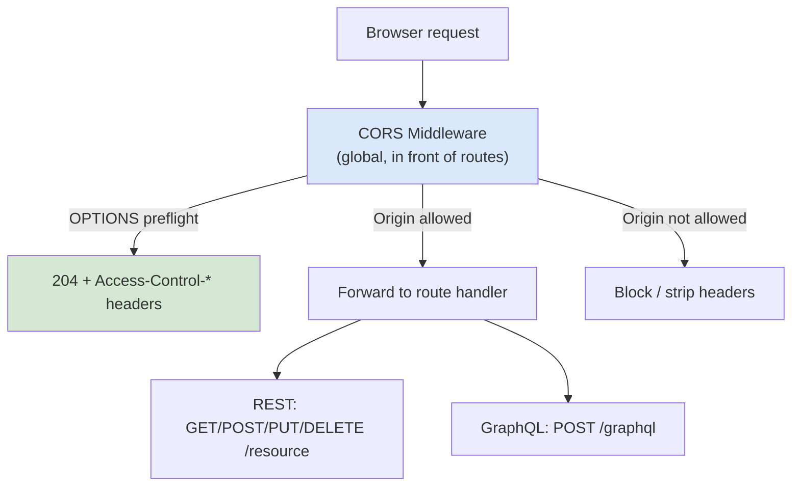

# 🧠 Topic: Handling CORS in APIs (REST & GraphQL)

> [!abstract] Executive Summary (ELI5)
> Every web framework has a CORS middleware that does the same job: read the request's `Origin`, validate it against your allowlist, and emit the right `Access-Control-Allow-*` headers — including a fast `204` for preflight `OPTIONS`. For **REST**, this means a single global middleware plus per-route exceptions; for **GraphQL**, the entire API is usually one POST endpoint, so the rules are simpler — but `application/json` always triggers a preflight, so handling `OPTIONS` correctly still matters. The goal everywhere is the same: **define the policy once, centrally, and keep it out of business logic.**

---

## 🎯 The "Why"
- **Problem Solved:** Almost every modern client (SPA, mobile-web-hybrid, third-party integration) calls APIs cross-origin. Hand-rolling CORS headers per endpoint is error-prone and inconsistent. Frameworks provide battle-tested middleware to centralize the policy.
- **Alternatives:** Push CORS up to the API Gateway or reverse proxy (see [[CORS_Alternatives]]) so the service code doesn't deal with it at all — useful when you have many services and want one consistent policy.
- **Trade-offs:** In-app middleware keeps CORS close to the route logic (per-route overrides easy) but spreads policy across services. Gateway-level CORS centralizes policy but removes per-route flexibility and couples you to gateway config.

## 💡 Mental Model & Analogy
- **Analogy:** "CORS middleware is the **reception desk at the front of your building**, not the security guard inside each office. Every visitor is checked once on entry — origin allowed? preflight answered? — and then walks freely to any office. REST is a building with many small offices (endpoints) — the desk handles them all by default but can be told 'this office is public, no badge needed.' GraphQL is one giant open-plan office (a single `/graphql` POST) — one rule covers everyone, but you still need the desk because every visitor carries a `application/json` briefcase that trips the preflight metal detector."
- **Visual/Diagram:**


## 🛠️ Core Principles

### General Pattern Across Frameworks
1. **Register CORS middleware globally**, before your routes.
2. **Configure an allowlist of origins** (production: explicit domains; dev: `localhost:3000` etc.).
3. **Whitelist methods and headers** your API actually uses.
4. **Handle preflight automatically** — return `204 No Content` with the right headers, skipping the route handler.
5. **Emit `Vary: Origin`** when the `Allow-Origin` value is dynamic.

### REST — Per-Framework Examples

**Express.js (Node.js)** — use the `cors` middleware rather than hand-rolling:
```js
const cors = require('cors');

const corsOptions = {
  origin: (origin, cb) => {
    const allowed = ['https://app.com', 'https://staging.app.com'];
    // allow same-origin / curl (no Origin) in API mode if appropriate
    if (!origin || allowed.includes(origin)) return cb(null, true);
    return cb(new Error('Not allowed by CORS'));
  },
  methods: ['GET', 'POST', 'PUT', 'DELETE', 'OPTIONS'],
  allowedHeaders: ['Content-Type', 'Authorization'],
  credentials: true,
  maxAge: 600,
};

app.use(cors(corsOptions));             // global default
app.options('*', cors(corsOptions));    // enable preflight across all routes
// Per-route override for a public endpoint
app.get('/public/health', cors({ origin: '*' }), healthHandler);
```

**Spring Boot (Java):**
```java
@Configuration
public class CorsConfig implements WebMvcConfigurer {
  @Override
  public void addCorsMappings(CorsRegistry registry) {
    registry.addMapping("/api/**")
        .allowedOrigins("https://app.com", "https://staging.app.com")
        .allowedMethods("GET", "POST", "PUT", "DELETE", "OPTIONS")
        .allowedHeaders("Authorization", "Content-Type")
        .allowCredentials(true)
        .maxAge(600);
  }
}
// Or per-controller: @CrossOrigin(origins = "https://app.com")
```

**Django (with `django-cors-headers`):**
```python
# settings.py
CORS_ALLOWED_ORIGINS = [
    "https://app.com",
    "https://staging.app.com",
    "http://localhost:3000",   # dev only
]
CORS_ALLOW_CREDENTIALS = True
CORS_PREFLIGHT_MAX_AGE = 600
# Add 'corsheaders' to INSTALLED_APPS and MIDDLEWARE (before CommonMiddleware).
```

**FastAPI / Starlette:**
```python
from fastapi import FastAPI
from fastapi.middleware.cors import CORSMiddleware

app = FastAPI()
app.add_middleware(
    CORSMiddleware,
    allow_origins=["https://app.com", "https://staging.app.com"],
    allow_credentials=True,
    allow_methods=["GET", "POST", "PUT", "DELETE", "OPTIONS"],
    allow_headers=["Authorization", "Content-Type"],
    max_age=600,
)
```

### GraphQL — One Endpoint, Simpler but Still Needs Preflight
GraphQL servers typically expose a **single POST endpoint** (`/graphql`), so CORS rules collapse to *one* route instead of many. Two important specifics:

1. **`application/json` always triggers preflight.** Most GraphQL clients (`apollo-client`, `urql`) POST JSON, so every request is preceded by an `OPTIONS` call on first use. Your server (or gateway) must handle `OPTIONS /graphql` and return `204` with the right headers, or queries silently fail.
2. **Use the same CORS middleware your HTTP framework provides.** Apollo Server, `express-graphql`, Mercurius, and others all sit on top of Express / Fastify / NestJS / Django — apply the framework's CORS middleware as if `/graphql` were any other route.

**Apollo Server on Express:**
```js
import { ApolloServer } from '@apollo/server';
import { expressMiddleware } from '@apollo/server/express4';
import cors from 'cors';
import express from 'express';

const app = express();
const server = new ApolloServer({ typeDefs, resolvers });
await server.start();

app.use(
  '/graphql',
  cors<cors.CorsRequest>({
    origin: ['https://app.com', 'https://staging.app.com'],
    credentials: true,
  }),
  express.json(),
  expressMiddleware(server),
);
```

**Apollo Server's standalone `startStandaloneServer`:**
```js
import { startStandaloneServer } from '@apollo/server/standalone';

const { url } = await startStandaloneServer(server, {
  listen: { port: 4000 },
  context: async ({ req }) => ({ /* … */ }),
});
// CORS is enabled by default with `origin: '*'` and `credentials: false`.
// Override via the `context`/headers if you need credentialed cross-origin.
```

### Per-Route vs Global Policy
- **Global default:** best practice for the 90% case. One allowlist, one `OPTIONS` handler, consistent behavior.
- **Per-route override:** when specific endpoints are public (health checks, public APIs, webhooks from third parties) — apply a more permissive policy only to those routes. Keep overrides the exception.

### CORS and Authentication Together
- If you authenticate with **cookies/sessions**, you need `Access-Control-Allow-Credentials: true` and a specific (non-`*`) origin. Pair with `SameSite` cookies and CSRF tokens (see [[Session_Security]]).
- If you authenticate with **Bearer tokens** in `Authorization` (JWT, OAuth), credentials mode is unnecessary — the client adds the header explicitly. But the `Authorization` header is custom → **always** triggers preflight.
- Either way, **CORS is not auth**. Even a perfectly configured CORS policy admits any approved origin; the API still must verify identity and authorize each action.

## ⚠️ Pitfalls & Anti-patterns
- **Hand-rolling CORS headers per route:** inconsistent, error-prone, easy to forget `OPTIONS`. Use the framework middleware.
- **Putting `cors()` *after* the route handlers in Express:** middleware order matters — if routes match first, CORS headers never get set.
- **Forgetting `express.json()` placement** between `cors()` and the GraphQL handler — JSON bodies silently rejected.
- **Hardcoding dev origins (`localhost:3000`) into production builds:** use environment variables; rotate them as environments change.
- **Different CORS policies across REST and GraphQL in the same app:** surprises in prod. Pick one policy and apply consistently unless a route genuinely needs an exception.
- **Returning CORS headers on success but not errors:** a 500 with no `Allow-Origin` makes the error body unreadable in the browser, hiding the cause. The framework middleware usually handles this — make sure it's not bypassed on error paths.

## 🔗 Deep Connections
- **Parent Topic:** [[01_CORS]]
- **Related Concepts:** [[Preflight_Requests]], [[CORS_Security_Risks]], [[CORS_Alternatives]], [[Session_Security]], [[Token_Based_Authentication]]
- **Prerequisites:** HTTP, REST or GraphQL basics, the framework you use.

## ❓ Active Recall Questions

> [!faq]- How do you configure CORS for a REST API? Give a representative framework example.
> Register a global CORS middleware with an explicit origin allowlist, allowed methods (`GET`/`POST`/`PUT`/`DELETE`/`OPTIONS`), allowed headers (`Authorization`, `Content-Type`), `credentials: true` if you use cookies, and a sensible `maxAge`. In Express use the `cors` package; in Spring `WebMvcConfigurer.addCorsMappings`; in Django `django-cors-headers` with `CORS_ALLOWED_ORIGINS`; in FastAPI `CORSMiddleware`. Always handle `OPTIONS` automatically and emit `Vary: Origin` when the origin is dynamic.

> [!faq]- What's different about CORS for a GraphQL API?
> Two things. First, GraphQL typically exposes a single POST endpoint (`/graphql`), so CORS rules collapse to one route. Second, every client POSTs JSON, and `application/json` always triggers a preflight — so your server must correctly answer `OPTIONS /graphql` with `204` and the right headers or queries silently fail. You use the same CORS middleware as the underlying HTTP framework (Express / Fastify / Django / etc.).

> [!faq]- A GraphQL client's queries silently fail in the browser but work in curl. What's the most likely cause?
> The preflight isn't being answered. `application/json` POSTs trigger an `OPTIONS /graphql` preflight; if your server (or router) returns `405` / doesn't set the CORS headers on the `OPTIONS` response, the browser never sends the real POST. curl works because it ignores CORS. Fix: register CORS middleware properly and ensure `OPTIONS` returns `204` with `Allow-Origin`, `-Allow-Methods`, `-Allow-Headers`.

> [!faq]- When would you use a per-route CORS override instead of a global policy?
> For genuinely public endpoints that need a more permissive policy than your authenticated API — health checks, public read-only APIs, third-party webhooks. Apply a stricter global default, then override only on those specific routes. Keep overrides the exception; the rule of thumb is one consistent policy across the app.

> [!faq]- Does cookie-based auth vs Bearer-token auth change your CORS setup?
> Yes. Cookie/session auth requires `Access-Control-Allow-Credentials: true` plus a specific origin (never `*`), and pairs with `SameSite` cookies and CSRF tokens. Bearer tokens in `Authorization` don't need credentials mode — the client sets the header explicitly — but `Authorization` is a custom header so it always triggers a preflight. In both cases, remember CORS only controls which origins may read responses; the API still authenticates and authorizes independently.

---

*Last updated: 2026-07-18*
