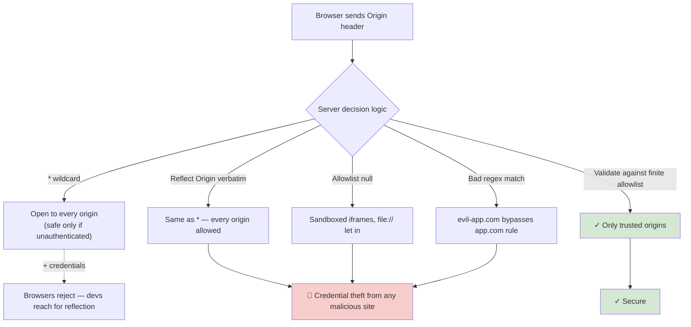

# 🧠 Topic: CORS Security Risks & Common Misconfigurations

> [!abstract] Executive Summary (ELI5)
> CORS itself isn't dangerous — **badly configured CORS is**. The headline rule: `Access-Control-Allow-Origin: *` plus `Access-Control-Allow-Credentials: true` is a contradiction the browser refuses, so devs who "need it to work" reach for dangerous shortcuts: reflecting the `Origin` header verbatim, allowlisting `null`, or whitelisting a regex that matches the attacker's domain. Each of those turns your API into an open vault that any malicious site can read on behalf of any logged-in user. Treat your origin allowlist like a firewall rule: explicit, validated, never reflected.

---

## 🎯 The "Why"
- **Problem Solved:** CORS relaxation of Same-Origin Policy ([[Same_Origin_Policy]]) is powerful — it lets any foreign origin potentially read sensitive responses. A misconfiguration silently re-opens the very attack SOP was designed to prevent.
- **Alternatives:** Don't relax CORS at all (force same-origin via a reverse proxy — see [[CORS_Alternatives]]). If you must relax it, scope it to the minimum set of trusted origins.
- **Trade-offs:** Stricter CORS (explicit allowlist, short `Max-Age`, no credentials) is safer but more operations overhead; looser CORS (`*`, reflected origins) is convenient and almost always wrong for anything authenticated.

## 💡 Mental Model & Analogy
- **Analogy:** "Your origin allowlist is a **VIP guest list at the door**. `*` means 'open house, anyone can come in' — fine for a public open day, terrible for a private dinner. Reflecting the `Origin` header is the bouncer saying 'whatever name you tell me, you're on the list' — functionally identical to no list at all. Allowlisting `null` is letting anyone in who shows up with no ID. Real security: a written, finite list, checked name by name, with credentials handed out only to people you explicitly trust."
- **Visual/Diagram:**


## 🛠️ Core Principles

### Risk 1 — Overly Permissive `Access-Control-Allow-Origin: *` *(PDF Q5)*
Returning `*` is fine **only** for fully public, unauthenticated resources (a public weather API, static CDN assets). For anything user-specific it's a data leak waiting to happen: combined with cookies the browser would let any site read authenticated responses. The spec forbids `*` + credentials, so devs "fix" it by *reflecting* the origin — see Risk 2.

### Risk 2 — Reflecting the `Origin` Header
The most common "I just want it to work" pattern:
```js
// 🚨 This is functionally equivalent to *
res.setHeader('Access-Control-Allow-Origin', req.headers.origin);
res.setHeader('Access-Control-Allow-Credentials', 'true');
```
This lets **any** origin make credentialed cross-origin requests. A malicious site can wait for a logged-in user, call your API with `credentials: 'include'`, and read the response. There is no allowlist — you've simply re-implemented `*` while fooling yourself that you have control.

**Correct:** validate `Origin` against a finite allowlist, then echo only if matched. Always emit `Vary: Origin` so caches key on the origin.
```js
const ALLOWED = new Set(['https://app.com', 'https://staging.app.com']);
const origin = req.headers.origin;
if (ALLOWED.has(origin)) {
  res.setHeader('Access-Control-Allow-Origin', origin);
  res.setHeader('Vary', 'Origin');
  res.setHeader('Access-Control-Allow-Credentials', 'true');
}
```

### Risk 3 — `Allow-Credentials: true` Without Restrictions *(PDF Q5)*
`Access-Control-Allow-Credentials: true` lets the browser send cookies and `Authorization` headers cross-origin. That's necessary for cookie-based auth on a SPA — but it turns CORS into a real security boundary. Rules:
- Never combine with `Allow-Origin: *` (browser refuses; devs then "fix" with reflection → Risk 2).
- Only pair with a finite, validated origin allowlist.
- Strongly prefer `SameSite=Lax`/`Strict` cookies alongside it (see [[Session_Security]]), and consider anti-CSRF tokens for state-changing endpoints.

### Risk 4 — Allowlisting the `null` Origin
Sandboxed `<iframe>`s, `data:` URIs, and `file://` pages send `Origin: null`. If your allowlist or reflection logic admits `null`, any of those contexts can call your credentialed API. Treat `null` as untrusted — never allowlist it.

### Risk 5 — Bad Regex / Subdomain Matching
Trying to allowlist "anything on app.com" with a sloppy check:
```js
// 🚨 Matches evil-app.com, app.com.evil.com, notapp.com
if (origin.endsWith('app.com')) { /* allow */ }

// 🚨 Forgets to anchor
if (/app\.com/.test(origin)) { /* allow */ }
```
**Correct:** match a precise pattern and anchor it, or compare exact strings:
```js
const ok = /^https:\/\/([a-z0-9-]+\.)?app\.com$/.test(origin)
        || origin === 'https://app.com';
```

### Risk 6 — Exposing Sensitive Headers Without Need
`Access-Control-Allow-Headers: *` (or listing `Authorization`, API keys) is sometimes necessary, but exposing internal/sensitive response headers via `Access-Control-Expose-Headers` (e.g. `X-Internal-User-Id`, `X-Debug-Token`) leaks internals to any approved origin. Expose only what client JS genuinely needs.

### Risk 7 — Forgetting CORS Is Not Authentication
CORS decides whether the *browser* hands a response to JS. It does not authenticate the user, authorize actions, or rate-limit. Always combine with real authentication ([[Session_Security]], [[Token_Based_Authentication]]) and authorization checks. A non-browser client (curl, mobile app, server) ignores CORS entirely — your server must protect itself independently.

### Mitigation Checklist *(PDF Q5)*
1. ✅ **Allowlist origins explicitly** — finite set, validated per request, never reflect blindly.
2. ✅ **Avoid `*` whenever credentials are involved** — pair credentials with a single specific origin.
3. ✅ **Treat `null` as untrusted** — never allowlist it.
4. ✅ **Anchor regexes** when matching subdomains — or compare exact strings.
5. ✅ **Emit `Vary: Origin`** so caches don't leak a response served for one origin to another.
6. ✅ **Pair with `SameSite` cookies + CSRF tokens** for state-changing endpoints.
7. ✅ **Implement real authentication & authorization** — CORS is not auth.
8. ✅ **Keep preflight `Max-Age` moderate** so policy changes roll out in reasonable time.

## ⚠️ Pitfalls & Anti-patterns
- **"It didn't work so I set everything to `*`":** the #1 cause of CORS vulnerabilities. Slow down; identify the missing header.
- **Trusting the `Referer` header instead of `Origin`:** `Referer` is omitted by `Referrer-Policy: no-referrer` and is path-bearing; `Origin` is the right header for CORS decisions.
- **Returning CORS headers on the preflight but not on the real response:** the real request still fails. Both responses must carry `Allow-Origin`.
- **Adding CORS headers to error responses incorrectly (Nginx without `always`):** the 4xx/5xx body becomes unreadable in JS, hiding real error info.
- **Allowing `OPTIONS` to skip auth without checking it's a preflight:** a real `OPTIONS` from a non-browser tool can bypass controls you put on other verbs. Verify it's actually a CORS preflight (has `Access-Control-Request-Method`).

## 🔗 Deep Connections
- **Parent Topic:** [[01_CORS]]
- **Related Concepts:** [[Same_Origin_Policy]], [[How_CORS_Works]], [[Preflight_Requests]], [[Session_Security]]
- **Prerequisites:** Same-Origin Policy, cookies, basic auth concepts.

## ❓ Active Recall Questions

> [!faq]- What are the common security risks associated with CORS? *(PDF Q5)*
> Three big ones: (1) Overly permissive `Access-Control-Allow-Origin: *` on authenticated resources → data leaks. (2) Allowing credentials (`Allow-Credentials: true`) without restricting origins → any site can make credentialed requests. (3) Exposing sensitive headers via `Allow-Headers` / `Expose-Headers`. Mitigate by allowlisting trusted origins explicitly, never pairing `*` with credentials, and pairing CORS with real authentication.

> [!faq]- Why is reflecting the `Origin` header into `Access-Control-Allow-Origin` a vulnerability?
> Reflection is functionally identical to `*` — every origin is "approved" — but it bypasses the browser's `*` + credentials block. Combined with `Allow-Credentials: true`, any malicious site can call your API on behalf of a logged-in user and read the response. The correct pattern: validate `Origin` against a finite allowlist, then echo only if it matches, with `Vary: Origin`.

> [!faq]- Why does `Access-Control-Allow-Credentials: true` raise the stakes on CORS config?
> It permits cookies and `Authorization` headers on cross-origin requests, turning CORS from "can JS read this public response" into "can a foreign site make authenticated calls." Now any origin misconfiguration means real credential-backed data theft. You must pair it with a single specific (non-`*`) origin, validated against an allowlist, plus `SameSite` cookies and CSRF tokens for state-changing endpoints.

> [!faq]- Why is `Origin: null` dangerous to allowlist?
> Sandboxed `<iframe>`s, `data:` URIs, and `file://` pages send `Origin: null`. If you admit `null`, any of those untrusted contexts can make credentialed calls against your API. Treat `null` as untrusted and never add it to an allowlist.

> [!faq]- Why must you anchor regexes when matching subdomains in CORS?
> `endsWith('app.com')` admits `evil-app.com` and `app.com.evil.com`; `/app\.com/` admits `notapp.com`. Anchor your pattern: `/^https:\/\/([a-z0-9-]+\.)?app\.com$/` — or compare against exact origin strings. A sloppy regex is the same as `*`.

> [!faq]- "I set everything to `*` to make CORS work." Why is this wrong, and what's the safe alternative?
> `*` on authenticated resources lets any site read user-specific responses, and it's outright rejected by the browser when credentials are involved. The safe alternative: maintain a finite origin allowlist, validate the `Origin` header against it per request, echo only the matched origin with `Vary: Origin`, and use `Allow-Credentials: true` only when you genuinely need cookies cross-origin.

---

*Last updated: 2026-07-18*
