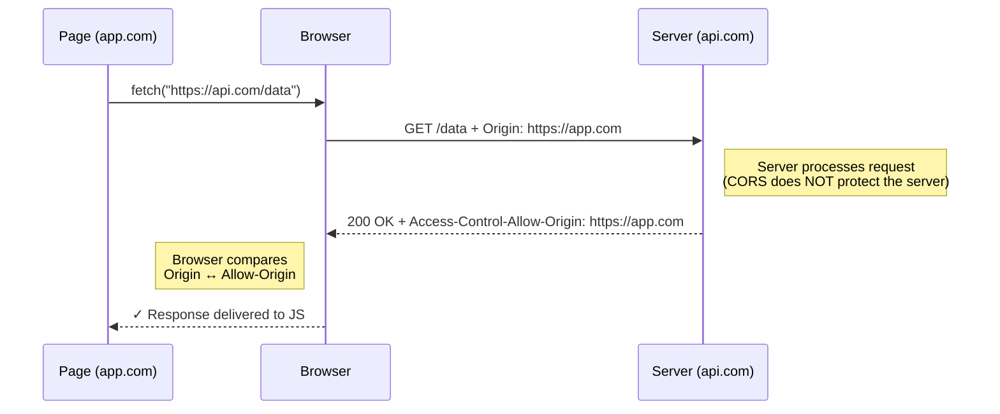

# 🧠 Topic: How CORS Works (Request & Response)

> [!abstract] Executive Summary (ELI5)
> CORS is a **two-party conversation mediated by the browser**. The browser, on behalf of a web page, sends a request that includes an `Origin` header. The server replies with `Access-Control-Allow-Origin`. The browser — not the server — compares them. If they match (or the server said `*` and no credentials are involved), the browser hands the response to JavaScript. If not, the browser blocks JS from reading it. **The server is never the CORS gatekeeper — the browser is.**

---

## 🎯 The "Why"
- **Problem Solved:** Same-Origin Policy ([[Same_Origin_Policy]]) blocks legitimate cross-origin apps (a SPA at `app.com` calling an API at `api.com`). CORS is the standardized, opt-in way for the *server* to tell the *browser* which foreign origins it's willing to serve.
- **Alternatives:** Reverse proxies (make both ends same-origin — see [[CORS_Alternatives]]); legacy JSONP (deprecated, unsafe).
- **Trade-offs:** CORS puts trust logic in HTTP headers, which is clean and standardized, but the rules are subtle (credentials, preflight, `null` origin) and easy to misconfigure. See [[CORS_Security_Risks]].

## 💡 Mental Model & Analogy
- **Analogy:** "CORS is like a **passport checkpoint at the API's border, run by the browser's own guards**. The web page hands its passport (`Origin` header) to the guard. The guard asks the server, 'Do you admit holders from this country?' The server sends back an admit-list (`Access-Control-Allow-Origin`). The guard — not the server — decides whether to open the gate and let the page see what's inside. The page never gets to negotiate directly with the server."
- **Visual/Diagram:**


## 🛠️ Core Principles

### The Full CORS Flow *(PDF Q2)*
1. **JS makes a cross-origin request** via `fetch` or `XMLHttpRequest`.
2. **The browser injects the `Origin` request header** automatically (`Origin: https://app.com`). The page cannot forge or omit it.
3. **The request is sent to the server.** The server runs normally — CORS does not protect the server, only the response reader.
4. **The server returns CORS response headers** if it wants to permit cross-origin access. The most important is:
   ```
   Access-Control-Allow-Origin: https://app.com
   ```
5. **The browser compares** `Origin` (request) with `Access-Control-Allow-Origin` (response). Match → JS gets the response. Mismatch → the network request still happened, but `fetch()` rejects with a CORS error and JS sees nothing.

### The CORS Response Headers (Quick Map)
Full mechanics for the preflight-triggering ones are in [[Preflight_Requests]]. The core set:

| Header | Purpose |
|---|---|
| `Access-Control-Allow-Origin` | Which origin may read the response (`https://app.com`, or `*` for "any") |
| `Access-Control-Allow-Credentials` | `true` if cookies / HTTP auth may be sent cross-origin |
| `Access-Control-Allow-Methods` | Which HTTP methods are permitted (used in preflight responses) |
| `Access-Control-Allow-Headers` | Which request headers the browser may send (preflight responses) |
| `Access-Control-Expose-Headers` | Which *response* headers JS is allowed to read (beyond the safe defaults) |
| `Access-Control-Max-Age` | How long the browser may cache the preflight result |

### Simple vs Preflight Requests
The browser decides *whether* a request needs a preflight `OPTIONS` call based on whether the request is "simple":

- **Simple request** → goes straight to the server, response headers decide on the way back.
- **Non-simple request** → browser sends `OPTIONS` preflight first; only sends the real request if preflight approves.

Triggers for preflight: methods other than `GET`/`HEAD`/`POST`; custom headers (anything beyond `Accept`, `Accept-Language`, `Content-Language`, `Content-Type` with safe values); and `Content-Type` values other than `application/x-www-form-urlencoded`, `multipart/form-data`, `text/plain`. See [[Preflight_Requests]] for the full flow.

### The `*` Wildcard — When It Works and When It Breaks
`Access-Control-Allow-Origin: *` means "any origin may read this." It is fine for *fully public, anonymous* resources (a public weather API, an open CDN asset).

It **does not work with credentials**. The browser will refuse a credentialed cross-origin request if the server replies `*`. To allow credentials you must echo a specific origin — never `*`. This is the most common CORS bug in production. See [[CORS_Security_Risks]].

### Credentialed Requests (`withCredentials`)
By default, cross-origin `fetch`/XHR does **not** send cookies or `Authorization` headers from other origins. To enable it:
- Client: `fetch(url, { credentials: 'include' })` or `xhr.withCredentials = true`.
- Server: must respond with `Access-Control-Allow-Credentials: true` **and** a specific (non-`*`) `Access-Control-Allow-Origin`.

### The `null` Origin Gotcha
A response from a sandboxed `<iframe>`, a `file://` page, or a `data:` URL carries `Origin: null`. Naively reflecting the `Origin` header into `Access-Control-Allow-Origin: null` opens your API to any sandboxed context. Never allowlist `null` blindly.

## ⚠️ Pitfalls & Anti-patterns
- **Reading server logs and concluding "the request reached my server, so CORS worked":** reaching the server proves nothing — SOP doesn't block sending, only reading. The error is purely a browser-side enforcement.
- **Setting `Allow-Origin: *` and wondering why credentialed requests fail:** browsers reject `*` + credentials. You must echo a specific origin.
- **Reflecting the `Origin` header verbatim into `Allow-Origin`:** that's the same as `*` from a security standpoint — you've just allowed every origin. Always validate against an allowlist first.
- **Forgetting `Access-Control-Expose-Headers`** when JS needs to read custom response headers (e.g. `X-Total-Count`, `Link`). They'll silently be invisible.
- **Caching preflight results incorrectly:** browsers cache based on `Access-Control-Max-Age`. A misconfigured `Allow-Origin` can be sticky for hours.

## 🔗 Deep Connections
- **Parent Topic:** [[01_CORS]]
- **Related Concepts:** [[Same_Origin_Policy]], [[Preflight_Requests]], [[CORS_Security_Risks]], [[Session_Security]]
- **Prerequisites:** HTTP headers, the browser fetch pipeline, Same-Origin Policy.

## ❓ Active Recall Questions

> [!faq]- How does CORS enable cross-origin requests? *(PDF Q2)*
> CORS is a browser security feature that allows controlled cross-origin access using HTTP headers. When JS makes a cross-origin request, the browser attaches an `Origin` header; the server returns `Access-Control-Allow-Origin` indicating which origins may read the response. The browser compares the two and only delivers the response to JS if they match (or the server returned `*`). Enforcement is on the browser side, not the server.

> [!faq]- Who actually enforces CORS — the server or the browser? Why does this distinction matter?
> The browser. The server just returns headers; the browser reads them and decides whether to expose the response to JS. This matters because (1) a CORS error means the request *still hit your server*, so CORS is not server protection, and (2) CORS is not authentication — it only protects the JS reading responses, not your endpoints from being called.

> [!faq]- Why does `Access-Control-Allow-Origin: *` break credentialed requests?
> The wildcard means "any origin," which combined with cookies/credentials would let any site make authenticated requests on a user's behalf. Browsers refuse the combination — when `Access-Control-Allow-Credentials: true`, you must return a specific origin, never `*`.

> [!faq]- What's the difference between a "simple" and a "preflighted" CORS request?
> Simple requests (`GET`/`HEAD`/`POST` with only safe headers and `Content-Type` in `application/x-www-form-urlencoded` / `multipart/form-data` / `text/plain`) go straight to the server and the response headers decide access. Non-simple requests (PUT/DELETE, custom headers like `Authorization`, `application/json` bodies) trigger an `OPTIONS` preflight first — only if the preflight approves does the browser send the real request. See [[Preflight_Requests]].

> [!faq]- Why is `Origin: null` a security gotcha?
> Sandbox frames, `file://`, and `data:` URLs send `Origin: null`. If your server reflects the origin or allowlists `null`, any sandboxed context can make an "allowed" cross-origin request against your API. Never blindly allowlist `null` — treat it as untrusted.

---

*Last updated: 2026-07-18*
