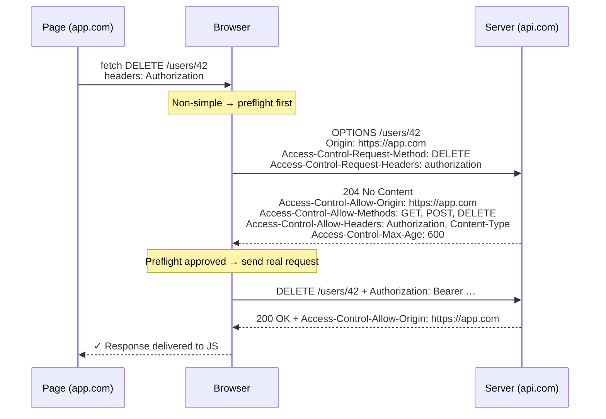

# 🧠 Topic: Preflight Requests & CORS Headers

> [!abstract] Executive Summary (ELI5)
> Before letting a web page send a "risky" cross-origin request (a `DELETE`, a custom header like `Authorization`, or a `application/json` body), the browser first whispers to the server: *"Hey, are you OK with method `DELETE` and header `Authorization` from `app.com`?"* That whisper is the **preflight** — an `OPTIONS` request with no body. The server answers with `Access-Control-Allow-Methods` / `-Headers` / `-Origin`. Only if the answer is yes does the browser send the real request. Preflight protects servers from receiving requests they can't safely handle, and it's *browser-initiated* — you can't turn it off from the client.

---

## 🎯 The "Why"
- **Problem Solved:** Same-Origin Policy ([[Same_Origin_Policy]]) blocks non-simple cross-origin reads. But many APIs legitimately need `PUT`/`DELETE`, custom headers, or JSON bodies. Preflight lets the server pre-approve such requests *before* the browser sends one that could have a side effect (e.g. an unintended `DELETE`).
- **Alternatives:** Restrict the API to only "simple" requests (no custom headers, form-encoded bodies only) — too limiting for modern APIs. Or use a reverse proxy to make everything same-origin so CORS never triggers (see [[CORS_Alternatives]]).
- **Trade-offs:** Preflight adds a round trip per distinct method/header combination on first use. `Access-Control-Max-Age` lets the browser cache the preflight result to amortize this cost.

## 💡 Mental Model & Analogy
- **Analogy:** "Preflight is the **bouncer checking your ID at the door before you walk in**. The real request is what you'd do inside the club. The bouncer (browser) radios ahead: 'This person wants to come in with a `DELETE` request and an `Authorization` token — cool?' If the club (server) says yes, you walk in. If no, you don't even get to try. The bouncer caches the answer for a while (`Max-Age`) so they don't have to radio ahead every single time."
- **Visual/Diagram:**


## 🛠️ Core Principles

### When Is a Preflight Required? *(PDF Q3)*
The browser sends a preflight when **any** of these is true:

1. **Method is not** `GET`, `HEAD`, or `POST` (so `PUT`, `PATCH`, `DELETE`, `OPTIONS` itself).
2. **Custom headers are set** — anything other than the CORS-safelisted set: `Accept`, `Accept-Language`, `Content-Language`, `Content-Type` (with safe values). Common triggers: `Authorization`, `X-Requested-With`, `X-CSRF-Token`, any `X-*` or app-specific header.
3. **`Content-Type` is not** one of: `application/x-www-form-urlencoded`, `multipart/form-data`, `text/plain`. So `application/json` (the most common modern body) **always** triggers a preflight.

If none of those apply → it's a "simple" request, no preflight; the server's CORS response headers decide access after the fact.

### The Preflight Request (`OPTIONS`)
The browser sends this *on its own* — your JS does not call it. It contains **no body** and **no credentials** in the standard case. Key headers:

```
OPTIONS /api/users/42 HTTP/1.1
Origin: https://app.com
Access-Control-Request-Method: DELETE
Access-Control-Request-Headers: authorization, content-type
```

### The Preflight Response
The server must respond (typically `200` or `204`) with the policy. Every relevant field must be present:

```
HTTP/1.1 204 No Content
Access-Control-Allow-Origin: https://app.com
Access-Control-Allow-Methods: GET, POST, PUT, DELETE, OPTIONS
Access-Control-Allow-Headers: Authorization, Content-Type
Access-Control-Allow-Credentials: true
Access-Control-Max-Age: 600
```

If any required field is missing or doesn't include what the real request needs, the browser aborts — the real request is **never sent**.

### The Full CORS Header Reference

**Request headers** (browser → server):

| Header | Who sets it | Purpose |
|---|---|---|
| `Origin` | Browser (always) | The origin of the page making the request |
| `Access-Control-Request-Method` | Browser (preflight only) | The method of the upcoming real request |
| `Access-Control-Request-Headers` | Browser (preflight only) | Custom headers the real request will send |

**Response headers** (server → browser):

| Header | Purpose |
|---|---|
| `Access-Control-Allow-Origin` | Permitted origin (specific, or `*` if no credentials) |
| `Access-Control-Allow-Methods` | Permitted HTTP methods (preflight response) |
| `Access-Control-Allow-Headers` | Permitted request headers (preflight response) |
| `Access-Control-Expose-Headers` | Which *response* headers JS may read beyond the safelisted defaults (`Cache-Control`, `Content-Language`, `Content-Type`, `Expires`, `Last-Modified`, `Pragma`) |
| `Access-Control-Allow-Credentials` | `true` permits cookies / HTTP auth on cross-origin requests |
| `Access-Control-Max-Age` | Seconds the browser may cache the preflight (Chrome caps ~7200s / 2h, Firefox ~86400s / 24h) |

### Configuring CORS Headers on the Server *(PDF Q4)*
CORS is a server-side concern: your backend (or gateway / reverse proxy) must return the correct headers. Two equally valid places to do it:

**In application code (Express.js):**
```js
app.use((req, res, next) => {
  const allowed = ['https://app.com', 'https://staging.app.com'];
  const origin = req.headers.origin;
  if (allowed.includes(origin)) {
    res.setHeader('Access-Control-Allow-Origin', origin);
    res.setHeader('Vary', 'Origin'); // cache correctly per origin
  }
  res.setHeader('Access-Control-Allow-Methods', 'GET, POST, PUT, DELETE, OPTIONS');
  res.setHeader('Access-Control-Allow-Headers', 'Content-Type, Authorization');
  res.setHeader('Access-Control-Allow-Credentials', 'true');
  res.setHeader('Access-Control-Max-Age', '600');
  if (req.method === 'OPTIONS') return res.sendStatus(204); // respond to preflight
  next();
});
```
Prefer a vetted middleware (e.g. the `cors` npm package) over hand-rolled header logic — the edge cases (credentials, `Vary`, `null` origin) are easy to miss.

**In a reverse proxy (Nginx):**
```nginx
location /api/ {
    add_header 'Access-Control-Allow-Origin' 'https://app.com' always;
    add_header 'Access-Control-Allow-Methods' 'GET, POST, PUT, DELETE, OPTIONS' always;
    add_header 'Access-Control-Allow-Headers' 'Authorization, Content-Type' always;
    add_header 'Access-Control-Allow-Credentials' 'true' always;
    add_header 'Access-Control-Max-Age' 600 always;
    if ($request_method = 'OPTIONS') {
        add_header 'Content-Length' '0';
        return 204;
    }
    proxy_pass http://backend-service/;
}
```
Use `always` so headers are added even on error responses (4xx/5xx) — otherwise the browser may block the error body too.

### `Access-Control-Max-Age` — The Performance Lever
Without caching, every preflight costs an extra round trip. With `Max-Age: 600`, the browser reuses the same preflight answer for 10 minutes for that (origin, method, headers) combination. Tune it high enough to amortize but low enough to roll out policy changes reasonably fast. Browsers cap the effective value (Chrome ~2h, Firefox ~24h).

## ⚠️ Pitfalls & Anti-patterns
- **Returning `200 OK` with a body from `OPTIONS`:** the body is wasted bytes; use `204 No Content`. More importantly, ensure the CORS headers are present on the preflight response itself.
- **Forgetting to handle `OPTIONS` in your router:** some frameworks treat `OPTIONS` as "method not allowed" and return 405 — preflight fails and the real request never fires.
- **Listing headers in `Allow-Headers` that don't match what the client sends:** the comparison is case-insensitive but exact on tokens. A missing `content-type` in the allow-list silently breaks JSON APIs.
- **Omitting `Vary: Origin`** when you echo the request origin: a CDN/proxy may cache the response for origin A and serve it to origin B, leaking the wrong `Allow-Origin`.
- **Setting `Max-Age: 0` or omitting it:** every request pays the preflight round-trip tax.
- **`add_header` in Nginx without `always`:** error responses (which often need CORS headers most, so the browser can surface the message) won't include them.

## 🔗 Deep Connections
- **Parent Topic:** [[01_CORS]]
- **Related Concepts:** [[How_CORS_Works]], [[CORS_Security_Risks]], [[CORS_In_APIs]], [[CORS_Alternatives]]
- **Prerequisites:** HTTP methods, HTTP headers, Same-Origin Policy.

## ❓ Active Recall Questions

> [!faq]- What is a preflight request, and when is it required? *(PDF Q3)*
> A preflight is an `OPTIONS` request the browser sends *before* the real cross-origin request to check whether the server allows it. It's required when (1) the method is anything other than `GET`/`HEAD`/`POST`, (2) the request sets custom headers like `Authorization`, or (3) the `Content-Type` is not `application/x-www-form-urlencoded`, `multipart/form-data`, or `text/plain` (so `application/json` always triggers one).

> [!faq]- Walk me through the preflight flow end to end.
> 1) Browser sends `OPTIONS` with `Origin`, `Access-Control-Request-Method`, and `Access-Control-Request-Headers`. 2) Server responds with `Access-Control-Allow-Origin`, `-Allow-Methods`, `-Allow-Headers` (and `-Allow-Credentials` / `-Max-Age` if applicable). 3) If approved, the browser sends the real request. 4) The server's response on the real request must *also* carry `Access-Control-Allow-Origin` or JS still can't read it.

> [!faq]- How do you configure CORS headers on a server? *(PDF Q4)*
> The server returns the right CORS headers in its response. In Express, set `Access-Control-Allow-Origin` (validated against an allowlist, never reflect blindly), `-Allow-Methods`, `-Allow-Headers`, optionally `-Allow-Credentials` and `-Max-Age`, and respond `204` to `OPTIONS`. In Nginx, use `add_header … always` and return `204` for `OPTIONS`. The four key headers are `Allow-Origin` (which domains), `Allow-Methods` (which verbs), `Allow-Headers` (which custom request headers), and `Allow-Credentials` (whether cookies may be sent).

> [!faq]- Name the three CORS *request* headers and the six CORS *response* headers.
> Request: `Origin` (always), `Access-Control-Request-Method` and `Access-Control-Request-Headers` (preflight only). Response: `Access-Control-Allow-Origin`, `-Allow-Methods`, `-Allow-Headers`, `-Expose-Headers`, `-Allow-Credentials`, `-Max-Age`.

> [!faq]- Why set `Access-Control-Max-Age`? What's a reasonable value?
> Each preflight is an extra round trip; `Max-Age` lets the browser cache the preflight answer for a given (origin, method, headers) tuple so subsequent requests skip it. 600 seconds (10 minutes) is a common production default — long enough to amortize across a session, short enough to roll out policy changes within minutes. Browsers cap the effective value (Chrome ~2h, Firefox ~24h).

> [!faq]- Why must you respond to `OPTIONS` in your framework's router?
> Browsers fire `OPTIONS` automatically for non-simple requests. If your router returns `405 Method Not Allowed` for `OPTIONS` (common default), the preflight fails and the real request is never sent — your API appears broken from the browser even though your handlers are correct.

---

*Last updated: 2026-07-18*
