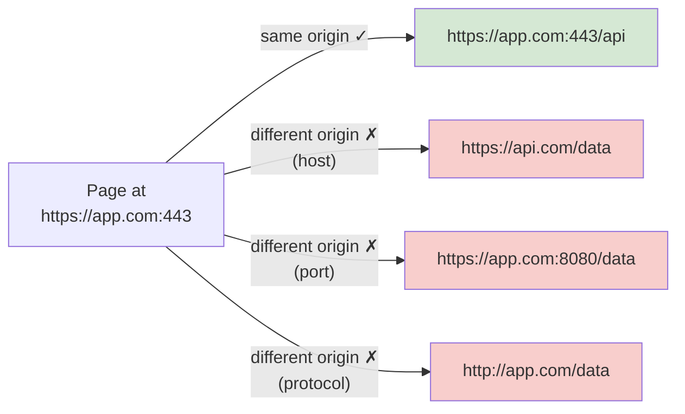

# 🧠 Topic: Same-Origin Policy (SOP)

> [!abstract] Executive Summary (ELI5)
> The browser has a strict "no talking to strangers" rule. A web page from `bank.com` is not allowed to silently read data from `evil.com` *or* from `api.other-site.com` — even though it can *send* requests there. This rule is the Same-Origin Policy, and it's the single most important security boundary in the browser. CORS is simply the controlled, opt-in way to relax that rule when two origins genuinely need to cooperate.

---

## 🎯 The "Why"
- **Problem Solved:** Without SOP, any website you visit could use JavaScript to silently talk to every other site where you're logged in (bank, email, internal company apps) and exfiltrate your data — because the browser would attach your session cookies automatically.
- **Alternatives:** None as a baseline — SOP is enforced by every modern browser by default. CORS, reverse proxies, and JSONP are *relaxations* of SOP, not replacements.
- **Trade-offs:** SOP prevents casual data theft but blocks legitimate cross-origin apps (SPA on `app.com` calling an API on `api.com`). Relaxing it safely is the entire job of CORS.

## 💡 Mental Model & Analogy
- **Analogy:** "An **origin** is like a workplace badge: it's the combination of *which building* (host), *which entrance* (port), and *which clearance* (protocol — staff door vs public). Same-Origin Policy says: your badge only opens doors in your own building. To enter another building you need a pre-arranged escort (CORS). Two badges that differ in *any* of building / entrance / clearance are *different* origins — even if both belong to the same company."
- **Visual/Diagram:**

## 🛠️ Core Principles

### What "Origin" Means Precisely *(PDF Q1)*
Two URLs have the **same origin** if and only if all three of these match:

| Component | Example |
|---|---|
| **Scheme (protocol)** | `https` vs `http` are *different* |
| **Host (domain)** | `app.com` vs `api.com` are *different* |
| **Port** | `:443` vs `:8080` are *different* (default ports implied) |

Everything else is ignored: path, query string, fragment. So `https://app.com/a` and `https://app.com/b?x=1#top` are **same origin** — only scheme/host/port matter.

### Why SOP Exists
- **Prevent unauthorized cross-origin actions** — a malicious page can't make requests on the user's behalf to other sites and quietly read the responses.
- **Protect sensitive user data** — auth tokens, session cookies, and personal data in API responses stay scoped to the origin they belong to.
- **Mitigate CSRF and related cross-site attacks** — SOP is the foundation that CSRF tokens and `SameSite` cookies build on (see [[Session_Security]]).

### The Critical Nuance: "Send" ≠ "Read"
This is the most misunderstood part of SOP and the source of countless interview confusions:

- **You CAN send** a cross-origin request (e.g. ``, `<form>` POST, `<script src>`, `fetch`) — the browser will fire it.
- **You CANNOT read** the *response* (for `fetch`/XHR) unless the server's CORS headers permit it.
- **Side effects still happen.** A `<form>` POST to a cross-origin endpoint still executes on the server — SOP only stops the *attacker's page* from seeing the response. This is exactly why **CSRF is possible at all** and why CSRF tokens / `SameSite` are needed alongside SOP.

### SOP ≠ CORS
- **SOP is the rule.** It's the default, browser-enforced, says "no."
- **CORS is the exception.** Server-originated HTTP headers (`Access-Control-Allow-Origin` etc.) tell the browser "yes, for this specific origin." See [[How_CORS_Works]].
- **CORS is not authentication.** CORS only decides whether the browser will *hand the response to JavaScript*. It does not authenticate the user, authorize the action, or replace auth tokens. A request with no CORS approval still hits your server — you just won't be able to read the response from the browser.

## ⚠️ Pitfalls & Anti-patterns
- **Thinking SOP blocks the request from reaching the server:** it doesn't. The request is sent; only the *response reading* by JS is blocked. State-changing requests are still CSRF risk.
- **Treating subdomains as same-origin:** `app.com` and `api.app.com` are *different origins*. Same applies to `localhost` vs `127.0.0.1`.
- **Believing CORS validates identity:** CORS validates *origin*, not *user*. Always combine with real authentication.
- **Forgetting the port:** `http://localhost:3000` and `http://localhost:8080` are different origins — a classic dev-time CORS error.

## 🔗 Deep Connections
- **Parent Topic:** [[01_CORS]]
- **Related Concepts:** [[How_CORS_Works]], [[Preflight_Requests]], [[CORS_Security_Risks]], [[Session_Security]]
- **Prerequisites:** HTTP, client-server model, basic understanding of cookies.

## ❓ Active Recall Questions

> [!faq]- What is the Same-Origin Policy, and why does it exist? *(PDF Q1)*
> SOP is a browser-enforced security mechanism that prevents scripts running on one origin (scheme + host + port) from reading resources from a different origin. It exists to stop malicious sites from silently making authorized requests on the user's behalf, protect sensitive data like auth tokens and session cookies, and form the foundation for mitigating cross-site attacks like CSRF.

> [!faq]- What three things define an "origin"? When are two URLs same-origin?
> Scheme (protocol), host (domain), and port. Two URLs are same-origin only if all three match exactly. Path, query string, and fragment are ignored. `https://app.com/a` and `https://app.com/b?x=1` are same-origin; `https://app.com` and `http://app.com` (scheme) or `https://api.app.com` (host) are not.

> [!faq]- Can a page send a cross-origin request even without CORS? If so, why is that a problem?
> Yes — SOP blocks *reading the response*, not *sending*. Forms, ``, `<script>`, and `fetch` all fire cross-origin. The problem is that state-changing requests (a POST transferring money) still execute on the server even when the attacker's JS can't read the response. That's the entire CSRF threat and why CSRF tokens / `SameSite` cookies are needed on top of SOP.

> [!faq]- Is CORS the same as authentication?
> No. CORS only tells the browser whether to *hand the response to JavaScript*. It validates **origin**, not **user**. A request without CORS still reaches your server and may execute. CORS must be combined with real authentication (sessions, JWTs) and authorization.

---

*Last updated: 2026-07-18*
