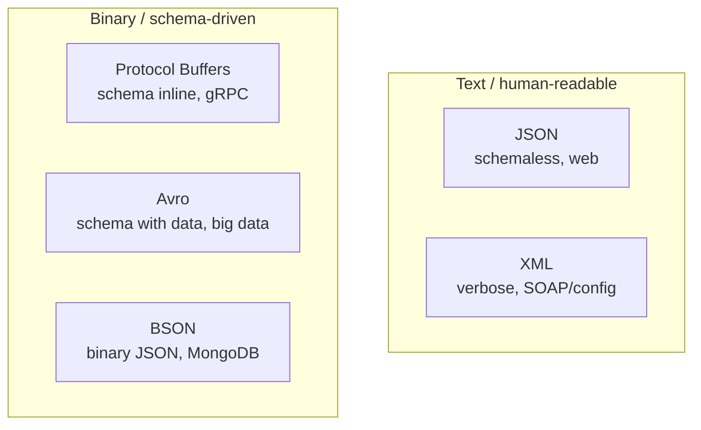

# 🧠 Topic: Serialization Formats

> [!abstract] Executive Summary (ELI5)
> Five formats dominate: **JSON** (the lingua franca of the web — readable, schemaless, a bit bulky), **XML** (older, verbose, used in SOAP/configs), **Protocol Buffers** (Google's compact binary format with a strict schema, the default for gRPC), **Avro** (binary with the schema stored *outside* the data — the darling of Hadoop/Kafka), and **BSON** (binary JSON used inside MongoDB for fast indexing). The rule of thumb: text formats (JSON/XML) optimize for humans and tooling; binary schema-driven formats (Protobuf/Avro) optimize for machines, bandwidth, and safe evolution.

---

## 🎯 The "Why"
- **Problem Solved:** Once you accept that objects must become bytes (see [[Serialization_Fundamentals]]), you need to choose *the byte vocabulary*. Different workloads reward different formats.
- **Alternatives:** This concept note *is* the comparison of alternatives — text vs binary, schemaless vs schema-driven, schema-inline (Protobuf) vs schema-out-of-band (Avro).
- **Trade-offs:** Readability, payload size, parse speed, type richness, schema/evolution story, ecosystem support. See [[Serialization_Tradeoffs]].

## 💡 Mental Model & Analogy
- **Analogy:** "JSON is plain English prose — anyone can read it, but it's wordy. XML is English with legalistic tags — even wordier, very formal. Protobuf is shorthand dictated from a codebook — tiny, but both sides need the codebook. Avro is shorthand where the codebook travels *with* the message — slightly more self-describing. BSON is JSON put through a binary compressor so a database can index it without re-parsing."
- **Visual/Diagram — Axis map:**


## 🛠️ Core Principles

### The Comparison Matrix
*(Extended from PDF Q3 — adds BSON, the storage-native format from Q11.)*

| Feature | JSON | XML | Protocol Buffers | Avro | BSON |
|---|---|---|---|---|---|
| **Human-readable** | ✅ Yes | ✅ Yes | ❌ No | ❌ No | ❌ No |
| **Schema required?** | ❌ No (optional via JSON Schema) | ❌ No (optional via XSD/DTD) | ✅ Yes (`.proto`) | ✅ Yes (`.avsc`, sent with data) | ❌ No |
| **Encoding** | Text (UTF-8) | Text (UTF-8) | Binary | Binary | Binary |
| **Payload size** | Medium | Large (most verbose) | Small | Small | Medium (binary JSON) |
| **Speed** | Moderate | Slow | Fast | Fast | Fast (indexable) |
| **Schema evolution** | None built-in | Weak (XSD) | Strong (field numbers) | Strong (writer/reader schema) | Weak |
| **Type richness** | Limited (no date/binary/decimal) | Limited | Rich (typed fields) | Rich | Rich (date, int32/64, binary) |
| **Common use** | Web APIs, REST, config | SOAP, enterprise configs, SVG | gRPC, microservices | Hadoop, Kafka, big data | MongoDB document storage |

### Format-by-Format

#### JSON — the default for the web
- Schemaless text; virtually every language has a parser.
- Limited types: strings, numbers (no separate int/float/decimal), booleans, null, arrays, objects. No native date or binary — they're faked as strings or Base64.
- Wins on **tooling and debuggability** (curl + a browser is enough). Loses on size and parse cost.

```json
{"id": 7, "name": "Ada", "roles": ["admin"], "active": true}
```

#### XML — verbose, formal, still everywhere
- Tag-based markup; supports attributes, namespaces, and rich validation (XSD).
- Heavy on the wire (lots of `<` `>` overhead); slow to parse.
- Still standard in **SOAP** web services, enterprise configs (Maven POMs, Spring), SVG, and many B2B/finance protocols.

```xml
<User id="7"><name>Ada</name><roles><role>admin</role></roles></User>
```

#### Protocol Buffers (Protobuf) — schema-inline binary
- Define a `.proto` schema, compile to language bindings, then serialize compact binary tagged by **field number**.
- Field numbers are what make evolution safe: add a new field with a new number, and old readers skip unknown fields gracefully (forward/backward compatibility).
- The default wire format for **gRPC** (see [[Serialization_In_APIs]] and PDF Q6).

```protobuf
message User {
  int64  id    = 1;
  string name  = 2;
  repeated string roles = 3;
  bool   active = 4;
}
```

#### Avro — schema-travels-with-data binary
- Schema is a JSON document (`*.avsc`); the **writer's schema is stored alongside the data** (e.g., in the Kafka message header, or at the start of an Avro file), and the reader reconciles with its own schema.
- That design makes schema evolution and long-term storage excellent — perfect for **Hadoop, Kafka, data lakes** where data outlives any single application version (PDF Q10).
- No field tags in the bytes → smaller payloads, but impossible to decode without the schema.

```json
{"type":"record","name":"User","fields":[
  {"name":"id","type":"long"},{"name":"name","type":"string"},
  {"name":"roles","type":{"type":"array","items":"string"}}]}
```

#### BSON — binary JSON for databases
- JSON's data model encoded as binary, with extra types (Date, int32/int64, BinData, Decimal128) and length prefixes that let you **skip through a document without parsing it**.
- That skip-ability is what makes MongoDB's indexing and projections fast (PDF Q11). See [[Serialization_In_Storage]].

### When to choose Protobuf over JSON
*(PDF Q4)*
- **Performance:** smaller payload, faster encode/decode → matters on high-throughput or bandwidth-constrained links.
- **Strong typing + schema:** catches contract drift at compile time instead of in production.
- **Evolvable contracts:** field numbers give you safe backward/forward compatibility.
- **gRPC pairing:** if you've already chosen gRPC, Protobuf is the default and natural fit.
- **Stay with JSON when:** humans need to read/debug payloads directly, the browser must consume the response without a schema, or flexibility/ad-hoc fields matter more than performance.

### Two sub-decisions people miss
1. **Schema-inline (Protobuf) vs schema-with-data (Avro):** Protobuf field tags make a message decodable *if* you have its `.proto`; Avro needs the writer's schema at read time. For long-lived storage (data lakes) Avro's schema-with-data wins; for RPC, Protobuf's stability wins.
2. **Type richness matters for fidelity:** JSON silently collapses ints and floats into "number"; if you store money or timestamps in JSON, decide the convention (strings? cents?) up front or you'll have a bad day.

## ⚠️ Pitfalls & Anti-patterns
- **Reaching for Protobuf in a browser-facing REST API** — there's no native browser parser and debugging is painful. Keep Protobuf behind gRPC or internal services.
- **Letting JSON carry money/timestamps without a convention** — `1.1 + 1.2`-style float drift will corrupt financial data. Use integers (cents) or strings (ISO-8601).
- **Choosing XML because "it's enterprise-grade"** — XML's verbosity and parse cost are real; don't pick SOAP/XML unless an external constraint (partner API, regulation, legacy system) forces it.
- **Ignoring schema evolution from day one** with Protobuf/Avro — the whole point of those formats is safe evolution; if you renumber Protobuf fields or rewrite Avro schemas destructively, you've thrown the benefit away.
- **Treating BSON like JSON** — same data model, very different on-disk reality. Don't hand-author BSON; let the driver produce it.

## 🔗 Deep Connections
- **Parent Topic:** [[01_Serialization]]
- **Previous:** [[Serialization_Fundamentals]]
- **Related Concepts:** [[Serialization_Tradeoffs]] (the cost side of this menu), [[Serialization_In_APIs]] (REST/JSON vs gRPC/Protobuf vs SOAP/XML), [[Serialization_In_Storage]] (BSON, Avro, Redis value formats).
- **Prerequisites:** Comfort with at least one format (JSON), and the concept of a *schema* (the `.proto` / `.avsc` / XSD idea).

## ❓ Active Recall Questions

> [!faq]- What are the key differences between JSON, XML, Protocol Buffers, and Avro? *(PDF Q3)*
> **Human-readable:** JSON/XML yes, Protobuf/Avro no. **Schema:** JSON/XML optional (JSON Schema / XSD), Protobuf/Avro required. **Encoding:** JSON/XML text, Protobuf/Avro binary. **Size:** XML large > JSON medium > Protobuf/Avro small. **Speed:** XML slow > JSON moderate > Protobuf/Avro fast. **Use case:** JSON for web APIs, XML for configs/SOAP, Protobuf for gRPC/microservices, Avro for Hadoop/Kafka big data.

> [!faq]- When would you choose Protocol Buffers over JSON? *(PDF Q4)*
> When **performance** (smaller payload, faster encode/decode), **strong typing** (compile-time contract checks), **safe schema evolution** (field numbers give backward/forward compatibility), or **gRPC** (Protobuf is gRPC's default wire format) outweigh the value of human readability. Stay with JSON when humans must read/debug payloads in the browser or when ad-hoc schemaless flexibility matters more.

> [!faq]- What is the schema-evolution story for Protobuf vs Avro, and why does it matter?
> Protobuf tags each field with a number; new fields get new numbers, unknown fields are skipped, so old and new code interoperate. Avro carries the **writer's schema** with the data and reconciles it with the **reader's schema** at decode time. This matters because services evolve independently: without these mechanisms, a producer adding a field would break consumers, or a data lake full of old records would become unreadable.

> [!faq]- Why does MongoDB use BSON instead of plain JSON? *(PDF Q11)*
> BSON is JSON's data model encoded as binary with length prefixes and richer types (Date, int32/int64, BinData, Decimal128). The length prefixes let MongoDB **traverse and index a document without fully parsing it**, and the richer types remove JSON's date/binary/decimal workarounds. The result: faster queries, efficient indexing, and faithful type fidelity on disk.

---

*Last updated: 2026-07-18*
