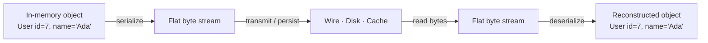

# 🧠 Topic: Serialization Fundamentals

> [!abstract] Executive Summary (ELI5)
> **Serialization** is packing a living, in-memory object into a flat box of bytes so it can travel over a network or sit on disk; **deserialization** is unpacking that box back into a live object on the other side. Every distributed system does this constantly — your API JSON, your Redis cache, your Kafka message, your DB row are all just serialized objects. The format you pick (JSON vs Protobuf vs Avro) decides how big the box is, how fast it packs/unpacks, and whether humans can read it.

---

## 🎯 The "Why"
- **Problem Solved:** Memory representations are language- and process-specific (pointers, layouts, types). To move data between processes, machines, or runs, you need a *canonical byte form* both sides agree on.
- **Alternatives:** The "alternative" isn't whether to serialize — it's *which format*. Text formats (JSON, XML) optimize for human readability; binary formats (Protobuf, Avro, BSON) optimize for size and speed; schema-driven formats (Protobuf, Avro) additionally optimize for safe evolution over time. See [[Serialization_Formats]].
- **Trade-offs:** You are always trading off **readability** vs **efficiency** vs **compatibility** vs **security**. See [[Serialization_Tradeoffs]].

## 💡 Mental Model & Analogy
- **Analogy:** "Serialization is like moving house. Your furniture is *arranged* in the rooms you live in (in-memory object). To move it, you disassemble it, wrap it, and label every piece so a stranger at the other end can reassemble it into the same room layout (serialized bytes → deserialized object). XML/JSON pack everything in labeled clear-plastic boxes — anyone can see what's inside, but it's bulky. Protobuf packs flat-pack furniture with a printed assembly schematic — much smaller, but only a reader with the schematic can reassemble it."
- **Visual/Diagram:**

## 🛠️ Core Principles

### What Serialization Actually Does
1. **Walks the object graph** — fields, nested objects, collections, references — and emits a deterministic byte encoding.
2. **Embeds type information** to some degree (format-dependent): JSON encodes it inline as keys; Protobuf relies on a shared `.proto` schema; Avro embeds the writer's schema with the data.
3. **Reverses the process** on the receiving side — reconstructing objects of the right types.

### The Four Reasons It's Unavoidable
*(PDF Q1 — why serialization is needed in system design)*
- **Data exchange:** APIs, RPC, message queues — every cross-process call needs it.
- **Storage:** Persisting structured data to a database row, document, or file.
- **Networking:** The wire only carries bytes; JSON/XML/Protobuf are the agreed alphabets.
- **Interoperability:** A Python service talking to a Go service needs a language-neutral format.

### How It Impacts Data Exchange and Storage
*(PDF Q2)*
- **Size:** Compact formats (Protobuf) cut bandwidth; verbose formats (XML) bloat it.
- **Speed:** Binary formats encode/decode faster than text.
- **Compatibility:** Some formats are human-readable (JSON, XML); others are performance-tuned (Avro, Protobuf) with strict schemas.
- **Data fidelity:** Naive serialization can lose precision (e.g., floats, big integers, time zones, distinctions between an absent field and a null one). Schema-driven formats reduce this risk.

### The Inverse Operation: Deserialization
- Same bytes, different reader, must produce an equivalent object.
- **Where the danger lives:** deserializing *untrusted* bytes can execute attacker-controlled code (see [[Serialization_Security]]). Treat any inbound serialized payload as hostile until validated.

### What Serialization Is *Not*
- **Not encryption:** Serialized data is plain unless you separately encrypt it. A signed JWT is still trivially Base64-readable.
- **Not compression:** A format may be compact, but it isn't general-purpose compression (you'd add gzip/zstd on top for that).
- **Not a database schema:** It's a wire/disk encoding; storage schema concerns (indexes, normalization) live on top of it.

## ⚠️ Pitfalls & Anti-patterns
- **Using a language-native format across services** (Java `Serializable`, Python `pickle`, Ruby `Marshal`) for inter-service calls — they're convenient, language-locked, and historically the source of trivial RCEs. Use a portable, schema-validated format instead.
- **Forgetting the absent-vs-null distinction** in JSON (`{"role": null}` vs `{}`) — leads to silent data bugs and ambiguous migrations.
- **Assuming round-tripping is free** — some types (timestamps, decimals, large ints, Unicode edge cases) don't round-trip cleanly through every format.
- **Confusing serialization with validation** — well-formed bytes can still be semantically invalid. Validate against a schema *and* your business rules.

## 🔗 Deep Connections
- **Parent Topic:** [[01_Serialization]]
- **Next concept:** [[Serialization_Formats]] — the concrete menu of formats and their trade-offs.
- **Related Concepts:** [[HTTP_Statelessness]] (stateless HTTP makes serialization the default way to pass data per request), [[State_Management_Techniques]] (JWTs, sessions, and cached values are all serialized artifacts).
- **Prerequisites:** Objects/structs in any language; the difference between in-memory representation and on-wire representation.

## ❓ Active Recall Questions

> [!faq]- What is serialization, and why is it needed in system design? *(PDF Q1)*
> Serialization is the process of converting an in-memory object or data structure into a byte format that can be stored, transmitted, and reconstructed later; the inverse is deserialization. It is needed for **data exchange** between systems (APIs, RPC, queues), **storage** (DB rows, files), **networking** (the wire only carries bytes), and **interoperability** (language-neutral formats let a Python service talk to a Go service).

> [!faq]- How does serialization impact data exchange and storage? *(PDF Q2)*
> The format choice governs four things: **size** (compact formats like Protobuf save bandwidth vs verbose XML), **speed** (binary encodes/decodes faster than text), **compatibility** (human-readable vs performance-tuned), and **data fidelity** (naive formats can lose precision on floats/big-ints/timestamps, so schema-driven formats reduce the risk). Same data, very different real-world cost depending on the pick.

> [!faq]- What goes wrong if you use Java `Serializable` or Python `pickle` for inter-service calls?
> They're language-native and not designed for untrusted input — deserializing an attacker-crafted payload can instantiate arbitrary classes and run arbitrary code (RCE). Use a portable, schema-validated format (JSON, Protobuf, Avro) for service-to-service traffic, and reserve native serializers for trusted internal state at most.

---

*Last updated: 2026-07-18*
