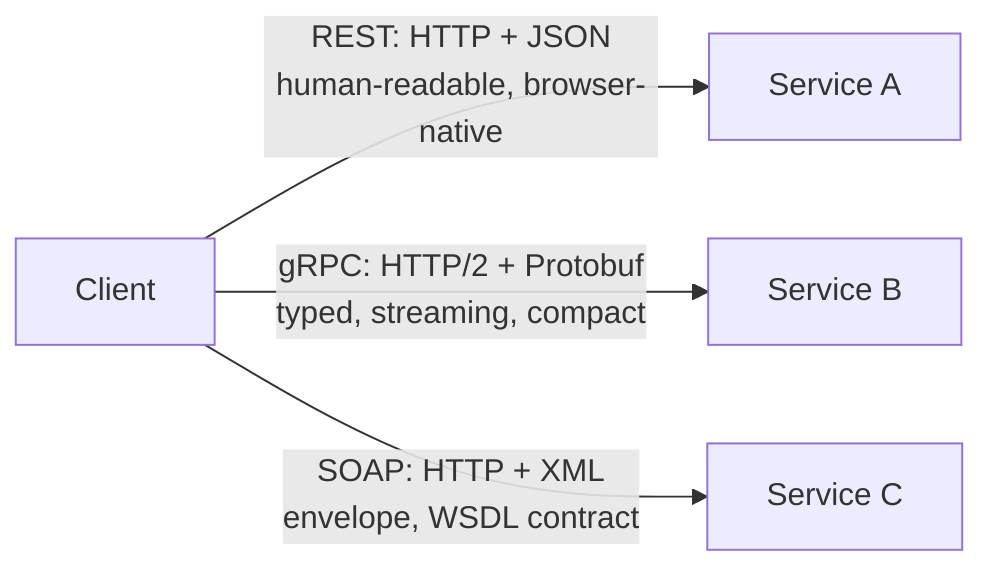

# 🧠 Topic: Serialization in APIs (REST, gRPC, SOAP)

> [!abstract] Executive Summary (ELI5)
> The wire format an API uses is rarely accidental — it follows the protocol's nature. **REST** pairs with **JSON** because browsers and humans love it. **gRPC** pairs with **Protocol Buffers** because it needs strict contracts, tiny payloads, and bidirectional streaming. **SOAP** pairs with **XML** because it formalizes enterprise messaging with envelopes and schemas. The format is part of the protocol's identity: picking gRPC *means* picking Protobuf.

---

## 🎯 The "Why"
- **Problem Solved:** Different API styles optimize for different things (human friendliness, performance, contract strictness, streaming). Each one has a serialization format that fits naturally.
- **Alternatives:** REST/JSON, gRPC/Protobuf, SOAP/XML — and a few hybrids (REST over Protobuf, GraphQL over JSON, WebSockets with JSON or MessagePack).
- **Trade-offs:** See [[Serialization_Tradeoffs]] — the same three axes (readability / efficiency / compatibility) decide which style fits each boundary in your system.

## 💡 Mental Model & Analogy
- **Analogy:** "REST/JSON is a postcard — anyone can read it, easy to send, no special equipment. gRPC/Protobuf is a sealed courier envelope with a typed manifest — faster, smaller, and contractually precise, but both ends need the manifest (the `.proto`). SOAP/XML is a registered letter in a legal envelope — heavy, formal, and exactly what big-enterprise integrations still demand."
- **Visual/Diagram — the three styles on one boundary:**


## 🛠️ Core Principles

### 1. REST + JSON — the web's default
- **Shape:** Plain HTTP verbs (`GET`, `POST`, …) over resources (`/users/7`), body and responses are JSON.
- **Why JSON wins here:** every browser, every language, every tool (`curl`, Postman, browser devtools) reads it natively; schemaless flexibility fits the heterogeneity of the public web.
- **Trade-off:** parsing cost and payload size dominate at high QPS — internal services often graduate to gRPC. See [[Serialization_Tradeoffs]].

```http
GET /users/7
HTTP/1.1 200 OK
Content-Type: application/json

{"id": 7, "name": "Ada", "roles": ["admin"]}
```

### 2. gRPC + Protocol Buffers — internal high-throughput RPC
*(PDF Q6 — why gRPC uses Protobuf instead of JSON)*
- **Shape:** define a `.proto` service and messages; gRPC generates client/server stubs; calls travel over **HTTP/2** with multiplexed streams and bidirectional streaming.
- **Why Protobuf (not JSON) is the default:**
  - **Binary format** — far smaller and faster than JSON, critical for high-throughput internal traffic.
  - **Schema enforcement** — the `.proto` is the contract; backward/forward compatibility is built in via field numbers (see [[Serialization_Formats]]).
  - **Efficient serialization** — minimal encode/decode overhead, designed for network transmission.
  - **Structured RPC** — gRPC's stubs, metadata, and streaming model assume a typed message format; Protobuf provides exactly that.

```protobuf
service UserService {
  rpc GetUser(GetUserRequest) returns (User);
}
message GetUserRequest { int64 id = 1; }
message User { int64 id = 1; string name = 2; repeated string roles = 3; }
```

### 3. SOAP + XML — the enterprise formalist
- **Shape:** an XML **envelope** (`<Envelope><Header/><Body>…</Body></Envelope>`) carrying typed payloads, with a **WSDL** contract describing operations and an optional **XSD** for the payload schema.
- **Why XML:** SOAP predates JSON's dominance and was designed for enterprise B2B — formal contracts, WS-Security, ACID transactions (WS-AtomicTransaction), and tooling-heavy codegen stacks (Java JAX-WS, .NET WCF).
- **Trade-off:** extremely verbose and slow to parse; only justified when an external constraint (partner system, regulation, legacy stack) requires it.

```xml
<soap:Envelope xmlns:soap="http://schemas.xmlsoap.org/soap/envelope/">
  <soap:Body>
    <GetUserResponse><User id="7"><name>Ada</name></User></GetUserResponse>
  </soap:Body>
</soap:Envelope>
```

### When to choose which

| Boundary | Pick | Reason |
|---|---|---|
| Public / browser-facing API | **REST + JSON** | Universal tooling, debuggable, native browser support |
| Internal microservice ↔ microservice | **gRPC + Protobuf** | Small, fast, typed, streaming |
| Partner integration that mandates SOAP | **SOAP + XML** | Interop with the partner's stack — not a free choice |
| Mobile client ↔ backend | **REST + JSON** (or gRPC-Web) | JSON is easy on mobile; gRPC-Web if you need streaming/typed contracts |
| Real-time bidirectional (chat, telemetry) | **gRPC** or **WebSockets + JSON/MessagePack** | Streaming model matters more than format |

### A subtle point: the format follows the protocol's *needs*
- REST is **resource + representation** oriented — the representation should be self-describing (JSON).
- gRPC is **action + typed message** oriented — the message should be contract-bound (Protobuf).
- SOAP is **envelope + contract** oriented — the envelope needs schema-rich markup (XML).
Picking the protocol and then fighting its natural format (e.g., REST over Protobuf with hand-rolled clients) is usually a smell — either change the protocol or accept its native format.

## ⚠️ Pitfalls & Anti-patterns
- **Using gRPC for browser-facing APIs without gRPC-Web** — browsers can't speak HTTP/2 trailers natively; you'll end up with a JSON gateway anyway.
- **Wrapping XML/SOAP around a brand-new internal service** — XML's verbosity and parse cost are real; choose SOAP only when an external constraint forces it.
- **Mixing formats inside one service boundary** — supporting both JSON and Protobuf on every endpoint adds maintenance burden; pick the dominant one and expose a gateway only where you genuinely need both.
- **Forgetting that REST still has a schema** — even without Protobuf, document your JSON with OpenAPI; "schemaless" is not "contractless."
- **Assuming gRPC is automatically faster end-to-end** — at small payloads or low QPS, JSON-over-HTTP/2 with compression can be competitive; benchmark before migrating.

## 🔗 Deep Connections
- **Parent Topic:** [[01_Serialization]]
- **Related Concepts:** [[Serialization_Formats]] (the formats behind each style), [[Serialization_Tradeoffs]] (the axes that decide which style fits), [[Microservices_Communication]] (sync vs async, RPC vs messaging).
- **Prerequisites:** HTTP request/response, the idea of an interface contract (WSDL, OpenAPI, `.proto`).

## ❓ Active Recall Questions

> [!faq]- Why is Protocol Buffers commonly used in gRPC instead of JSON? *(PDF Q6)*
> Four reasons: (1) **binary format** — much smaller and faster than JSON; (2) **schema enforcement** — the `.proto` guarantees backward/forward compatibility via field numbers; (3) **efficient serialization** — minimal overhead, optimized for network transmission; (4) **structured RPC fit** — gRPC's typed stubs, metadata, and streaming model assume a strongly-typed message format, and Protobuf provides exactly that.

> [!faq]- When would you choose Protobuf over JSON for an API? *(PDF Q4)*
> Choose Protobuf when performance (smaller payloads, faster encode/decode), strong typing (compile-time contract checks), safe schema evolution, or gRPC pairing outweigh human readability. Keep JSON for browser-facing or low-traffic public APIs where debuggability and universal tooling matter more.

> [!faq]- REST uses JSON, gRPC uses Protobuf, SOAP uses XML. Why does each protocol pair with that specific format?
> The format matches the protocol's nature. REST is resource + representation oriented and needs a self-describing, browser-native format → JSON. gRPC is action + typed-message oriented and needs compact, contract-bound, streaming-friendly payloads → Protobuf. SOAP is envelope + formal-contract oriented and needs schema-rich markup → XML. Fighting the natural pairing (e.g., REST over hand-rolled Protobuf) is usually a smell.

> [!faq]- When does SOAP/XML still make sense in a modern system?
> When an external constraint forces it: a partner or regulated industry (finance, healthcare, government) mandates SOAP, or you must integrate with a legacy stack (JAX-WS, WCF) that speaks it natively. For greenfield internal work, XML's verbosity and parse cost almost never justify the choice — REST/JSON or gRPC/Protobuf are better defaults.

---

*Last updated: 2026-07-18*
