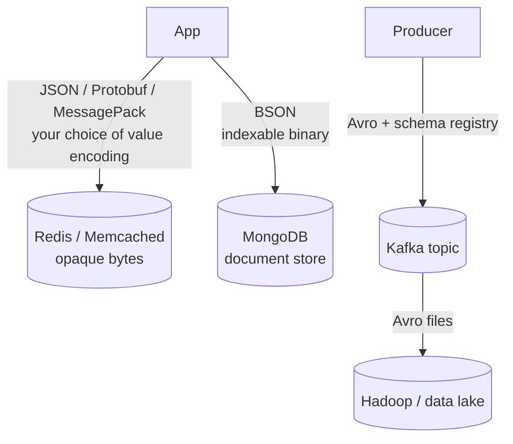

# 🧠 Topic: Serialization in Caching & Data Storage

> [!abstract] Executive Summary (ELI5)
> Storage and caching systems care about serialization even more than APIs do, because the bytes persist longer and are touched more often. **Redis/Memcached** store whatever bytes you hand them — you choose JSON for debuggability or Protobuf/MessagePack for speed. **MongoDB** uses **BSON** so it can index and skip through documents without re-parsing. **Hadoop/Kafka** pipelines use **Avro** because records outlive any single version of the code, and Avro's schema-travels-with-data model keeps them readable for years.

---

## 🎯 The "Why"
- **Problem Solved:** Once data sits in a cache or a database (not just flies over the wire), the cost model changes: read/write latency, indexability, type fidelity, and *long-term schema evolution* all start to matter.
- **Alternatives:** Different stores pick (or let you pick) different formats: opaque blobs in Redis, BSON in MongoDB, Avro in data lakes, row/columnar formats in OLAP.
- **Trade-offs:** See [[Serialization_Tradeoffs]] — readability vs efficiency vs compatibility, plus a storage-specific axis: **indexability and skip-ability**.

## 💡 Mental Model & Analogy
- **Analogy:** "A cache is a coat-check room — the clerk doesn't care what shape your coat is in, only that the ticket matches (Redis). A document DB is a filing cabinet that needs to flip to *page 3 of every folder* without unfolding the whole folder (BSON's length prefixes). A data lake is an archive where boxes from 2018 must still be openable in 2030 even though the box-maker went out of business — so each box ships with its own assembly instructions taped to the lid (Avro's writer schema)."
- **Visual/Diagram:**

## 🛠️ Core Principles

### 1. Redis and Memcached — opaque bytes, your choice
*(PDF Q7 — how serialization affects caching strategies)*
- Both are **pure key-value stores over bytes**. They don't know or care what's inside the value — you serialize before `SET` and deserialize after `GET`.
- **Common choices:**
  - **JSON** — human-readable, easy to debug in `redis-cli`, flexible schemas. Default for many teams.
  - **MessagePack / Protobuf / Avro** — when you need lower latency or smaller footprint at high cardinality (millions of keys).
  - **Language-native serializers** (e.g., a framework's `pickle`/`Marshal`) — convenient, but they create portability and security headaches (see [[Serialization_Security]]).
- **What the format drives:**
  - **Latency:** compact formats reduce time spent on the wire and in deserialize.
  - **Compression:** you can `SET` a pre-compressed blob (or use Redis on-disk RDB compression) for storage efficiency.
  - **Lookup speed:** smaller values fit more in memory and reduce eviction churn; the key lookups themselves are O(1), but deserialize cost is per-read.
- **Rule of thumb:** start with JSON while you're debugging; switch the hottest/largest value classes to MessagePack or Protobuf only when profiling says to.

### 2. Databases — when the format is part of the engine
*(PDF Q11 — MongoDB and BSON)*
- **MongoDB stores BSON**, not JSON. BSON is JSON's data model encoded as binary with length prefixes and richer types (Date, int32/int64, BinData, Decimal128).
- **Why BSON beats plain JSON for a database:**
  - **Length prefixes** → MongoDB can skip to a field without parsing the whole document, making indexing and projections fast.
  - **Type richness** → no JSON-style date/binary/decimal hacks; types are first-class.
  - **Scan efficiency** → smaller on-disk footprint than equivalent JSON, faster scans.
- **Other stores and their formats:** PostgreSQL rows use a binary page format; Cassandra uses a custom row format; OLAP engines (ClickHouse, Parquet on S3) use **columnar** encodings (values of one column packed together for vectorized scans and high compression).

### 3. Big Data — Avro on Hadoop and Kafka
*(PDF Q10 — why Avro is beneficial in big data systems)*
- Big-data workloads have a defining property: **records outlive the code that produced them.** A Kafka topic written in 2024 may be replayed by a consumer written in 2027; a Parquet/Avro file in a data lake may be queried years after the producing service was decommissioned.
- **Avro is the standard answer because:**
  - **Schema evolution** — fields can be added, removed, or renamed without breaking readers; the writer's schema and reader's schema are reconciled at decode time.
  - **Schema travels with data** — Avro files embed the writer's schema at the head; Kafka pairs each message with a schema ID from a **schema registry**, so any consumer can fetch the exact schema the producer used.
  - **Binary and compact** — small on disk, fast to process, ideal for streaming and batch.
- **The pattern in practice:** Producer registers its Avro schema in a Schema Registry → writes Avro-encoded messages to Kafka → consumers look up the schema by ID and decode. Adding a field is a non-event as long as you follow compatibility rules (BACKWARD/FORWARD/FULL).

### Storage-specific axis: Indexability and Skip-ability
A format's value isn't just size and speed — it's whether a reader can **jump to the part it needs**:
- **JSON:** no — must parse front-to-back.
- **BSON:** yes — length prefixes let you skip elements.
- **Protobuf:** partial — fields are tagged, unknown fields can be skipped.
- **Columnar (Parquet/ORC):** maximal — whole columns are contiguous, so analytics scans touch only the columns they need.

This is why columnar formats dominate OLAP and BSON dominates document DBs, even though both are "binary."

## ⚠️ Pitfalls & Anti-patterns
- **Storing language-native blobs in Redis** and assuming other services can read them — locks you to one language and creates deserialization attack surface.
- **Caching huge JSON blobs untrimmed** — caching the entire API response when you only needed one field wastes memory and inflates deserialize cost; cache the projection.
- **Evolving Avro schemas without checking compatibility mode** — a "small" rename or type change can break every downstream consumer; configure the Schema Registry's compatibility level and test it.
- **Treating MongoDB like a JSON file** — the JSON you send over the wire is *not* what's stored; understand BSON's types (ObjectID, Decimal128, Date) or you'll get silent type coercion bugs.
- **Using JSON for Kafka at scale** — works at low volume, but the parse cost and absence of a schema story make Avro (or Protobuf) the better long-term choice.

## 🔗 Deep Connections
- **Parent Topic:** [[01_Serialization]]
- **Related Concepts:** [[Serialization_Formats]] (BSON, Avro, JSON, Protobuf), [[Serialization_Tradeoffs]] (size/CPU/compat), [[State_Management_Techniques]] (Redis as a session store), [[Scaling_Session_Management]] (distributed session stores).
- **Prerequisites:** Key-value vs document vs columnar storage models; the concept of a schema registry.

## ❓ Active Recall Questions

> [!faq]- How does serialization affect caching strategies in systems like Redis? *(PDF Q7)*
> Redis and Memcached are opaque key-value stores over bytes — you serialize before `SET` and deserialize after `GET`, so the format choice drives **latency** (compact formats cut decode time), **storage efficiency** (you can compress blobs), and **lookup behavior** (smaller values mean less memory pressure and eviction). JSON is the debug-friendly default; MessagePack/Protobuf/Avro win at high cardinality or for hot values.

> [!faq]- Why do some databases like MongoDB use BSON instead of JSON? *(PDF Q11)*
> BSON is JSON's data model encoded as binary with length prefixes and richer types (Date, int32/int64, BinData, Decimal128). The length prefixes let MongoDB **skip through a document without fully parsing it**, which makes indexing and projections fast. The richer types remove JSON's date/binary/decimal workarounds. The net effect: faster queries, efficient indexing, and faithful type fidelity on disk.

> [!faq]- How is Avro beneficial in big data systems like Hadoop and Kafka? *(PDF Q10)*
> Three reasons: (1) **schema evolution** — fields can be added/removed/renamed without breaking readers, because the writer and reader schemas are reconciled at decode time; (2) **schema travels with data** — Avro files embed the writer's schema, and Kafka pairs each message with a schema ID from a registry, so records stay readable for years; (3) **binary and compact** — small on disk and fast to process, ideal for streaming and batch. Big data's defining property is that records outlive the code that produced them, and Avro is engineered for exactly that.

> [!faq]- Your team stores JSON blobs in Redis and a profiling pass shows deserialize is a hot path on the read side. What do you do?
> First, cache the projection you actually need, not the whole API response — that alone can shrink values and parse cost. For the hottest value classes, switch the encoding to MessagePack (smallest behavior change, still schemaless) or Protobuf (if you want a typed contract). Don't switch to a language-native format — you'll lose cross-language portability and add a deserialization attack surface.

---

*Last updated: 2026-07-18*
