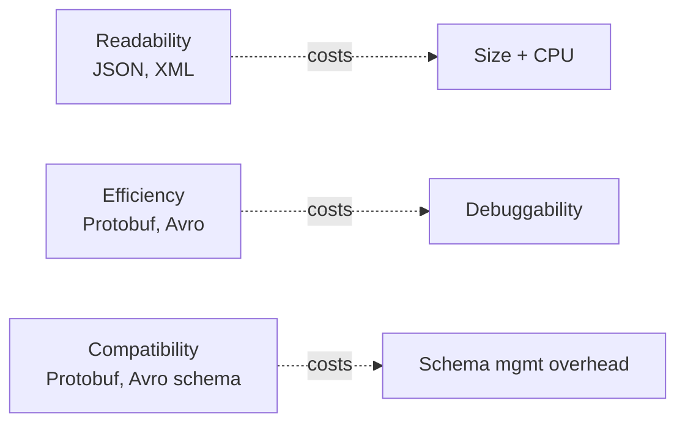

# 🧠 Topic: Serialization Trade-offs

> [!abstract] Executive Summary (ELI5)
> Every serialization choice forces a three-way trade between **readability** (can a human debug this with `curl`?), **efficiency** (how big is the payload, how much CPU does parsing burn?), and **compatibility** (can old and new code keep talking as the schema changes?). Text formats win readability but lose on size and CPU; binary formats flip that. Schema-driven binary formats (Protobuf, Avro) buy compatibility on top of efficiency. There is no free lunch — the right pick depends on which axis hurts most in your system.

---

## 🎯 The "Why"
- **Problem Solved:** Once you know the menu of formats (see [[Serialization_Formats]]), you need a decision framework. This note is the framework.
- **Alternatives:** The three axes (readability / efficiency / compatibility) are the alternatives to each other — you optimize one at the cost of the others.
- **Trade-offs:** This *is* the trade-offs note. The headline tension: text formats cost CPU and bandwidth; binary formats cost debuggability and ecosystem friction.

## 💡 Mental Model & Analogy
- **Analogy:** "Imagine shipping the same bookshelf to a friend. JSON is a letter describing every shelf in plain English — anyone can read it on arrival, but the letter is long. XML is the same letter with legal footnotes for every sentence — even longer. Protobuf is a flat-pack with an instruction sheet — tiny and quick, but useless to anyone without the sheet. Avro is the flat-pack *with the sheet taped to the box*. Each is 'correct'; the question is what your friend (the receiver) and the courier (the network) can afford."
- **Visual/Diagram — the three axes:**

## 🛠️ Core Principles

### The Three Axes (PDF Q8)

| Axis | Winner | Cost paid |
|---|---|---|
| **Readability** | JSON, XML | Larger size, slower parsing |
| **Efficiency** | Protobuf, Avro | Requires schema management; hard to eyeball |
| **Compatibility** | Protobuf, Avro (schema-driven) | Schema/tooling overhead; JSON is flexible but unstructured |

The deep insight: **JSON is flexible and widely supported, but binary schema-driven formats are what *guarantee* structured compatibility** — flexibility and compatibility are not the same thing.

### CPU and Memory Impact (PDF Q9)
- **Text formats (JSON, XML):** higher CPU due to string parsing, hash-table building for objects, and dynamic typing; allocations spike on large payloads.
- **Binary formats (Protobuf, Avro):** lower CPU and memory — fixed-width fields, length prefixes, and precompiled decoders avoid re-parsing and re-typing.
- **Pathological cases:** deeply nested or huge JSON documents can balloon memory (the parser builds the whole tree before you can stream it). Streaming parsers (SAX, `simdjson`, Jackson streaming) help; binary formats are inherently closer to streaming-friendly.

### API Performance Impact (PDF Q5)
Serialization drives three things on every API call:
1. **Response time** — lighter formats (Protobuf) reduce payload size, which reduces both serialization CPU and time-on-wire.
2. **Processing overhead** — JSON/XML parsing dominates CPU on hot paths; binary formats move that cost dramatically down.
3. **Bandwidth consumption** — efficient serialization cuts egress cost and is often the cheapest way to make an API more scalable (you can serve more requests per NIC/CPU before saturating).

> [!tip] Profiling rule of thumb
> If your service is CPU-bound and JSON parsing shows up in the flame graph, switching hot internal calls to Protobuf/gRPC is usually a bigger win than any micro-optimization. For browser-facing endpoints, keep JSON but consider a fast parser (`simdjson`) and compression (gzip/brotli).

### A Worked Decision Guide

| If your system is… | Pick | Why |
|---|---|---|
| Browser-facing public API | **JSON** | Universal tooling, debuggable, native browser support |
| Internal microservice-to-microservice, high QPS | **Protobuf over gRPC** | Small payloads, low CPU, strict contracts, streaming |
| Data lake / Kafka pipeline, records outlive code | **Avro** | Schema travels with data; great evolution story |
| Partner B2B / legacy enterprise integration | **XML / SOAP** | Interop with the existing stack |
| Document database storage | **BSON** (MongoDB) | Indexable binary, richer types than JSON |
| Human-edited configuration | **JSON or YAML** | Readability wins, perf is irrelevant |

### Compression: the Orthogonal Lever
- Serialization compactness and compression are **independent**. You can gzip JSON, zstd Protobuf, or Snappy Avro.
- Diminishing returns: a gzipped JSON payload is often *smaller than uncompressed Protobuf*, but it still costs more *CPU* to produce and parse. Combine them deliberately (e.g., HTTP `Accept-Encoding: gzip` for JSON responses; Snappy on Avro in Kafka for speed).

## ⚠️ Pitfalls & Anti-patterns
- **Premature Protobuf-ification** of a low-traffic public API — you pay the schema/tooling cost and lose debuggability for no measurable benefit.
- **Ignoring CPU cost of JSON in hot paths** — at scale, JSON parsing genuinely dominates; measure before assuming the network is the bottleneck.
- **Conflating "flexible" with "compatible"** — JSON lets you add fields freely, but without a schema, consumers silently break on type/shape changes. Flexibility without a contract is technical debt.
- **Comparing uncompressed binary to uncompressed text** without accounting for compression — decide your real baseline (compressed or not) before benchmarking.
- **Forgetting that schemas are code** — Protobuf/Avro schemas need versioning, review, and a registry, just like any other contract.

## 🔗 Deep Connections
- **Parent Topic:** [[01_Serialization]]
- **Previous:** [[Serialization_Formats]] (the format menu this note reasons about).
- **Related Concepts:** [[Serialization_In_APIs]] (applies these trade-offs to REST/gRPC/SOAP), [[Serialization_In_Storage]] (applies them to Redis/MongoDB/Kafka).
- **Prerequisites:** The formats themselves (JSON, XML, Protobuf, Avro, BSON) and the concept of payload size vs parse cost.

## ❓ Active Recall Questions

> [!faq]- What are the trade-offs between readability, efficiency, and compatibility in serialization formats? *(PDF Q8)*
> **Readability:** JSON/XML are easy to read but large and slow to parse. **Efficiency:** Protobuf/Avro are compact and fast but require schema management and are not human-readable. **Compatibility:** JSON is flexible and ubiquitous, but that's not the same as compatibility — schema-driven formats (Protobuf, Avro) are what *guarantee* safe evolution. You optimize one axis at the cost of the others.

> [!faq]- How does serialization impact CPU and memory usage? *(PDF Q9)*
> Text formats (JSON, XML) burn more CPU on string parsing and object construction, and large or deeply nested payloads spike memory because the parser builds a full tree before you can use it. Binary formats (Protobuf, Avro) have lower CPU and memory footprints thanks to fixed-width fields, length prefixes, and precompiled decoders. At scale, inefficient serialization is a common hidden CPU bottleneck.

> [!faq]- How does serialization affect API performance and efficiency? *(PDF Q5)*
> Three ways: (1) **Response time** — lighter formats reduce payload size, cutting both serialization CPU and time-on-wire. (2) **Processing overhead** — text parsing dominates CPU on hot paths; binary formats cut it sharply. (3) **Bandwidth** — efficient serialization reduces egress cost, which is often the cheapest path to scaling an API further.

> [!faq]- You're CPU-bound on a high-QPS internal service that speaks JSON over HTTP. What's the highest-leverage fix?
> Move the hot internal calls from JSON-over-HTTP to Protobuf-over-gRPC. The CPU saved on parsing (and the smaller payloads) typically dwarf micro-optimizations. Keep JSON for any browser-facing endpoint where debuggability and native browser support matter more.

---

*Last updated: 2026-07-18*
