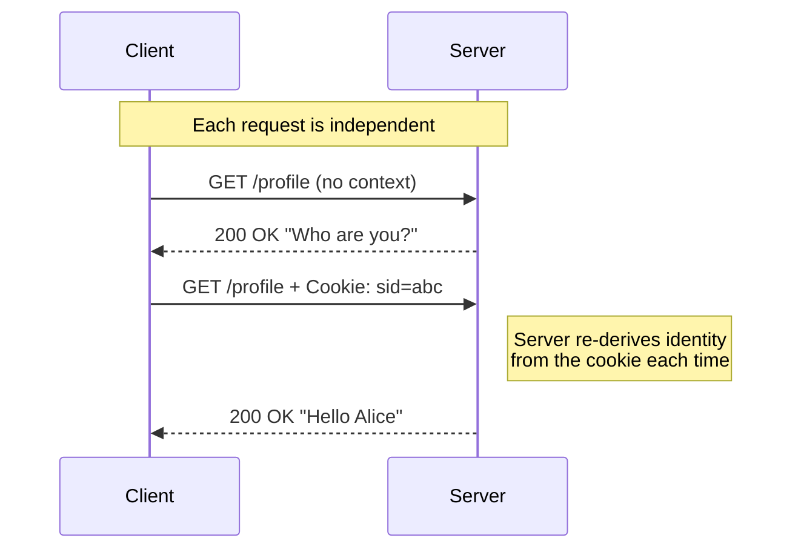

# 🧠 Topic: HTTP Statelessness

> [!abstract] Executive Summary (ELI5)
> HTTP is a "goldfish protocol" — by design, every request is treated as a brand-new encounter. The server has no memory of any previous request you made. This makes servers incredibly easy to scale (any server can handle any request), but it means the application has to bolt on extra machinery (cookies, sessions, tokens) to remember who you are.

---

## 🎯 The "Why"
- **Problem Solved:** Statelessness keeps the server simple and horizontally scalable. No server needs to hold per-user state to do its job, so any server behind the load balancer can serve any client.
- **Alternatives:** Stateful protocols (FTP, traditional telnet, database connections) keep a live session on the server. They are easier to program against but much harder to scale and recover.
- **Trade-offs:** You gain scalability, fault-tolerance, and cacheability; you lose the ability to "remember" the user. Every interactive feature (login, shopping cart, preferences) requires an external state layer.

## 💡 Mental Model & Analogy
- **Analogy:** "A stateless server is like a fast-food drive-through. Every time you pull up, the cashier asks for your order from scratch — they don't remember what you ordered last time. If you want them to know you're 'the usual', you have to hand them a loyalty card (cookie/session token) every single visit."
- **Visual/Diagram:**

## 🛠️ Core Principles

### What "Stateless" Actually Means
HTTP is considered stateless because each request from a client to a server is treated as an **independent transaction**. The server does not retain any memory of previous interactions between requests. The request itself must carry everything the server needs to fulfill it (verb, path, headers, body, and any identity token).

### Why HTTP Was Designed Stateless
- **Simplicity:** No per-connection bookkeeping on the server. A worker process can handle one request, then immediately handle a totally different client's next request.
- **Scalability:** Any node behind a load balancer can serve any request — there is no "sticky" session affinity required. You scale by adding more identical servers.
- **Fault tolerance:** If a server crashes mid-conversation, no client state is lost — the next request simply lands on another server.
- **Cacheability:** Because the same request yields the same response (when no identity is attached), intermediaries (CDNs, proxies, browsers) can cache responses aggressively.

### The Cost: Applications Need State Anyway
Real applications are inherently stateful: a logged-in user, a shopping cart, a multi-step checkout, a draft email. Because the protocol refuses to remember, state has to live somewhere. The three families of techniques (covered in [[State_Management_Techniques]]):

| Where the state lives | Mechanism | Example |
|---|---|---|
| **Entirely on the client** | Cookies, `localStorage` | Non-sensitive UI preferences |
| **On the client as a pointer; data on the server** | Session ID cookie → server-side session store | Traditional web app login |
| **On the client, self-contained and signed** | JWT / opaque token | API and microservice auth |

### Statelessness vs Idempotence — Don't Confuse Them
- **Stateless:** the *server* keeps no memory between requests (a property of HTTP).
- **Idempotent:** the *same request repeated* has the same effect as doing it once (a property of an HTTP method: `GET`, `PUT`, `DELETE` are idempotent; `POST` is not).
- They are independent: HTTP is stateless AND defines some methods as idempotent. Knowing both matters in interviews.

### The REST Connection
Roy Fielding's REST constrains statelessness explicitly: *"Client-server communication must be stateless in nature … session state is kept entirely on the client."* Every request must contain all information needed to be understood in isolation. Violations (server storing per-client session state) are technically "stateful REST" — common in practice, but a recognized compromise.

## ⚠️ Pitfalls & Anti-patterns
- **Storing auth state only in-memory on one server:** works on a laptop, breaks the moment you load-balance. Use a shared session store or stateless tokens (see [[Scaling_Session_Management]]).
- **Treating `POST` as idempotent:** retries on network failure can double-charge. Add idempotency keys for sensitive writes.
- **Embedding sensitive data directly in cookies without signing/encryption:** clients can read and tamper with cookie contents.
- **Assuming stateless = unauthenticated:** stateless means *the server holds no state*; the request still carries identity in a header/cookie.

## 🔗 Deep Connections
- **Parent Topic:** [[01_Web_Sessions]]
- **Related Concepts:** [[State_Management_Techniques]], [[Session_Based_Authentication]], [[Token_Based_Authentication]], [[Client_Server_Model]]
- **Prerequisites:** basic HTTP methods, client-server model.

## ❓ Active Recall Questions

> [!faq]- Why is HTTP considered a stateless protocol? *(PDF Q1)*
> Because each request is treated as an independent transaction — the server retains no memory of previous interactions. This simplifies server design and makes horizontal scaling trivial, but forces the application to layer on cookies, sessions, or tokens to maintain any kind of user state.

> [!faq]- If HTTP is stateless, how does any web app "remember" you?
> It doesn't remember via the protocol. The application bolts state on top: cookies carry identifiers (session IDs or JWTs), the server looks up or verifies that identifier on every request, and reconstructs the user's context from scratch each time. See [[State_Management_Techniques]].

> [!faq]- What's the upside of HTTP's statelessness?
> Scalability and resilience. Any server behind a load balancer can serve any request, so you scale by adding nodes; if a node dies, no client state is lost. It also makes responses cacheable by intermediaries.

> [!faq]- Statelessness vs idempotence — what's the difference?
> Statelessness is a property of the protocol: the server keeps no memory between requests. Idempotence is a property of a method: repeating the same call has the same effect as doing it once (`GET`/`PUT`/`DELETE` are; `POST` is not). They are independent concepts.

---

*Last updated: 2026-07-18*
