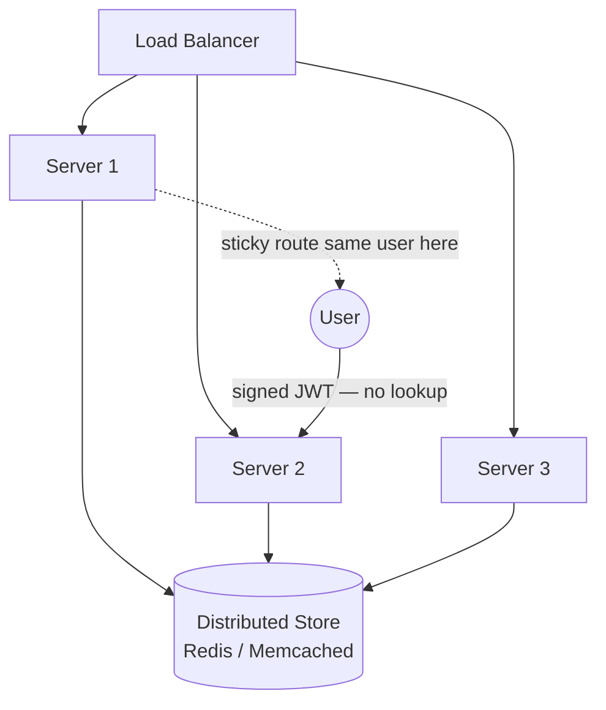

# 🧠 Topic: Scaling Session Management

> [!abstract] Executive Summary (ELI5)
> One server holding your login in memory works fine — until you add a second server and your users start getting logged out at random. The three classic ways to fix this at scale are **sticky sessions** (always send a user back to the same server), **distributed session stores** (move the sessions into a shared cache like Redis/Memcached), and **stateless authentication with JWT** (carry the session inside the token so there's nothing on the server to share). Big platforms like Google and Amazon combine all of these with SSO, refresh tokens, and short-lived access tokens.

---

## 🎯 The "Why"
- **Problem Solved:** Once you load-balance across multiple servers, a session stored on one node is invisible to the others — the user appears logged out whenever they hit a different node.
- **Alternatives:** The three families below are the alternatives; they trade operational simplicity, latency, and revocability against each other.
- **Trade-offs:** Sticky sessions are simple but unbalance the cluster and hurt failover. Distributed stores give full flexibility but add a dependency and a network hop. Stateless JWT scales furthest but gives up cheap revocation.

## 💡 Mental Model & Analogy
- **Analogy:** "Imagine a chain of coffee shops sharing one loyalty program. **Sticky sessions** = you must always return to the same branch — convenient for them, annoying if that branch is closed. **Distributed store** = every branch looks up your account in the same shared database — flexible, but the database is now critical. **Stateless token** = your loyalty card is a signed, self-describing badge — any barista in any branch can verify it on the spot, no database call, but the card works until it expires and HQ can't revoke it remotely."
- **Visual/Diagram:**


## 🛠️ Core Principles

### The Core Problem *(PDF Q10 framing)*
If a session is stored on one server, another server in the load balancer pool may not have access to it. Three classic solutions:

1. **Sticky sessions (session affinity)** — the load balancer pins each user to one node.
2. **Distributed session store** — sessions live in Redis, Memcached, or a DB shared by all nodes.
3. **Stateless JWT auth** — sessions aren't stored on servers at all.

### How Session Management Scales in Distributed Systems *(PDF Q9)*

#### Option A — Sticky Sessions
- The load balancer uses a cookie or client IP hash to route every request from a given user to the **same backend node**, which keeps its session in local memory.
- **Pros:** trivial to implement; no shared store; lowest latency.
- **Cons:**
  - **Unbalanced load** — a heavy user pins one node while others sit idle.
  - **Poor failover** — if *that* node dies, every session on it is lost; users are logged out.
  - **Scaling friction** — adding/removing nodes reshuffles the hash and breaks sessions.
- Best for small/medium apps or as a transitional step.

#### Option B — Distributed Session Stores
- Move sessions out of process memory into a fast shared datastore — typically **Redis** or **Memcached**, or a DB like **DynamoDB**.
- Every node reads/writes the same store, so any node can serve any request.
- **Pros:** true horizontal scaling, good failover (a node can die), balanced load.
- **Cons:** adds a network hop and a critical dependency (the store going down logs everyone out); operational cost.
- **Redis vs Memcached (quick):**
  - **Redis** — persistence, rich data types, replication, atomic operations, single-threaded but fast. Better when you need durability or structures (e.g. session + rate-limit counters).
  - **Memcached** — simpler, multi-threaded, very fast, volatile only. Fine for pure ephemeral sessions where losing all sessions on restart is acceptable.

#### Option C — Stateless Authentication (JWT)
- Issue a signed JWT; every node verifies the signature locally and reads claims from the token. **No session store at all.**
- **Pros:** maximum scalability — adding nodes requires zero session coordination; perfect for microservices and APIs.
- **Cons:** hard to revoke before expiry; large cookies/headers; payload is readable (not encrypted).
- Usually paired with short access tokens + refresh tokens to recover some revocation control. See [[Token_Based_Authentication]].

### How a Load-Balanced System Handles Session Storage *(PDF Q10)*
- **Problem:** if a session lives on one server, another server in the pool may not have access to it.
- **Solutions:**
  - Use **sticky sessions** to ensure a user's requests always reach the same server.
  - Store sessions in a **distributed session store** (Redis, DynamoDB, Memcached).
  - Use **JWTs for stateless auth**, removing the per-node session dependency entirely.
- Most production systems pick **distributed store** or **JWT**, and use sticky sessions only as a tactical optimization (e.g. for socket connections).

### Auth Across Many Microservices *(PDF Q11)*
In a microservices architecture you manage authentication across services by:
- Using a **centralized authentication service** (OAuth 2.0 / OpenID Connect IdP).
- Issuing **JWTs valid across all services** — every service trusts the same issuer.
- Each service **validates the token locally** without calling the auth server on every request (no per-request hop).
- Using **refresh tokens** so clients stay authenticated long-term without re-logging in constantly.
- Optionally **gateway-level validation**: an API gateway verifies the token once and forwards identity headers to internal services.

```
Client ── Bearer JWT ──▶ API Gateway ──verify──▶ Service A, B, C (trust gateway / verify locally)
                            │
                            └── on 401 ──▶ Auth Service (login / refresh)
```

### How Big-Scale Platforms Handle Sessions *(PDF Q12)*
Facebook-, Amazon-, Google-scale systems handle sessions by combining techniques:
- **Token-based authentication** (JWTs, OAuth/OIDC) for scalability across services.
- **Distributed session stores** (Redis, Cassandra, DynamoDB) for any state they *do* keep server-side.
- **Single Sign-On (SSO)** for seamless auth across many products — one identity, many services.
- **Short-lived access tokens paired with refresh tokens** for security — if a token leaks, the blast radius is small.
- **Edge / regional session services** to keep session lookups close to users (low latency).
- **Step-up authentication** for sensitive actions (re-enter password / 2FA) rather than re-issuing a fully privileged session.

## ⚠️ Pitfalls & Anti-patterns
- **Choosing sticky sessions for a system that needs failover:** one dead node logs out every user pinned to it.
- **Treating Redis as infinitely scalable:** a single Redis instance becomes the bottleneck; plan for sharding/clustering and persistence trade-offs.
- **JWTs without short TTL or revocation list:** a stolen token is valid until expiry. Use refresh-token rotation + a revocation list for high-risk sessions.
- **Each microservice calling the auth service on every request:** reintroduces the central bottleneck JWT was meant to remove. Validate locally.
- **Forgetting to plan for store failure:** if Redis dies, everyone logs out. Replicate, back up, and have a degradation strategy.
- **Ignoring session TTLs at scale:** abandoned sessions fill the store; set absolute + idle expiry and clean up.

## 🔗 Deep Connections
- **Parent Topic:** [[01_Web_Sessions]]
- **Related Concepts:** [[Session_Based_Authentication]], [[Token_Based_Authentication]], [[Load_Balancing_Introduction]], [[Microservices_Overview]], [[Microservices_Communication]]
- **Prerequisites:** load balancers, caching, microservice basics.

## ❓ Active Recall Questions

> [!faq]- How can session management be scaled in distributed systems? *(PDF Q9)*
> Three ways: (1) **Sticky sessions** — route each user to the same backend node via the load balancer. (2) **Distributed session stores** — keep sessions in Redis, Memcached, or a DB shared by all nodes. (3) **JWTs / stateless auth** — remove server-side session storage entirely by carrying a signed token. Most systems use option 2 or 3, with sticky sessions only for specific cases like WebSocket connections.

> [!faq]- How does a load-balanced system handle session storage? *(PDF Q10)*
> The problem: a session stored on one node is invisible to others in the pool. Solutions: sticky sessions to keep a user on one node; a distributed session store (Redis/DynamoDB) so every node sees the same sessions; or JWTs for stateless auth, which removes the per-node session dependency entirely.

> [!faq]- In a microservices architecture, how do you manage auth across multiple services? *(PDF Q11)*
> Use a centralized authentication service (OAuth 2.0 / OpenID Connect) that issues JWTs valid across services. Each service validates the token locally without calling the auth server on every request, and refresh tokens enable long-term auth without frequent re-login. An API gateway can verify once and propagate identity headers internally.

> [!faq]- How do platforms like Facebook, Amazon, or Google handle user sessions efficiently? *(PDF Q12)*
> They combine techniques: token-based auth (JWT, OAuth) for cross-service scalability; distributed stores (Redis, Cassandra, DynamoDB) for any server-side state they keep; single sign-on (SSO) for seamless auth across products; and short-lived access tokens paired with refresh tokens so a leaked token has limited blast radius. Regional edge session services keep latency low.

> [!faq]- What's the trade-off between sticky sessions and a distributed session store?
> Sticky sessions are simplest and lowest-latency but unbalance the cluster and lose all pinned sessions when a node dies. A distributed store balances load, survives node failures, and lets any node serve any user — at the cost of a network hop and a new critical dependency you must operate and replicate.

> [!faq]- When is JWT the wrong answer for scaling sessions?
> When you need instant revocation (you'd have to maintain a server-side blocklist — defeating the statelessness), when tokens would be very large, or when you only have a single traditional server-rendered app where a simple server-side session is simpler and safer.

---

*Last updated: 2026-07-18*
