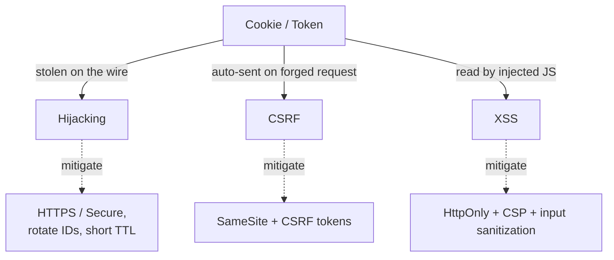

# 🧠 Topic: Session Security

> [!abstract] Executive Summary (ELI5)
> A session token is a temporary spare key to your account. If an attacker steals it, they become you — no password required. The three big threats are **hijacking** (stealing the key), **CSRF** (tricking your browser into using the key for an action you didn't intend), and **XSS** (malicious JS reading the key from the page). Defense is layered: encrypt the wire (HTTPS), hide the cookie from JS (`HttpOnly`), block cross-site sends (`SameSite`), and use one-time CSRF tokens for state changes.

---

## 🎯 The "Why"
- **Problem Solved:** A valid session ID is as good as a password — protecting it is the entire game of session security.
- **Alternatives:** Defense-in-depth (combine several controls) vs single-point controls (rely on HTTPS alone). Defense-in-depth is the only credible approach because each layer covers the others' gaps.
- **Trade-offs:** Tighter security (short expiry, `SameSite=Strict`, frequent re-auth) costs user friction. Pick controls per the sensitivity of the action.

## 💡 Mental Model & Analogy
- **Analogy:** "Think of three attacks against a hotel. **Hijacking** = someone pickpockets your room key. **CSRF** = a stranger tricks the receptionist into accepting your key for a delivery you never ordered, while you're relaxing upstairs. **XSS** = a fake brochure slipped under your door contains a magnifying glass that lets a thief read the key in your hand. Defenses: the key only works over the secure corridor (HTTPS), can't be photographed by brochures (HttpOnly), and the desk double-checks unusual deliveries (CSRF tokens)."
- **Visual/Diagram:**


## 🛠️ Core Principles

### Threat 1 — Session Hijacking *(PDF Q6)*
Session hijacking occurs when an attacker steals a user's session ID and uses it to impersonate them. The ID can be stolen off the wire (no HTTPS), from a leaked cookie, from logs, or via XSS that reads a non-HttpOnly cookie.

Prevention:
- Use the **`Secure`, `HttpOnly`, and `SameSite`** cookie attributes (below).
- Enforce **SSL/TLS end-to-end** so the session ID is never readable on the wire.
- **Rotate the session ID** after login or any privilege escalation (defeats session fixation).
- Use **short-lived session expiration** and require re-authentication for sensitive actions.
- Bind the session loosely to client properties (user-agent / IP) for anomaly detection — but never rely on IP alone (NAT, mobile networks).

### Threat 2 — CSRF (Cross-Site Request Forgery) *(PDF Q7)*
CSRF occurs when an attacker tricks an already-authenticated user's browser into submitting an **unintended request** to a trusted site. Because cookies are attached automatically, the forged request looks authenticated. The user never sees the request happen.

Mitigation strategies:
- **Anti-CSRF tokens:** a server-issued, per-session unguessable token required for every state-changing request (typically embedded in forms / custom header). Same-origin policy stops a malicious site from reading it.
- **`SameSite=Lax` or `SameSite=Strict`** on session cookies — restricts cross-site cookie sends.
- **Require re-authentication** for sensitive operations (password change, money transfer, account deletion).
- **Enforce CORS policies** so unauthorized origins can't make credentialed cross-origin requests.

### Threat 3 — XSS (Cross-Site Scripting)
XSS happens when attacker-controlled JavaScript runs in the context of your page. It can read non-HttpOnly cookies and `localStorage`, forge requests on the user's behalf, or deface the page. It's the JavaScript-side counterpart to CSRF.

Mitigations:
- **`HttpOnly`** cookies (JS can't read them).
- **Content Security Policy (CSP)** — restricts script sources.
- Strict **input validation / output encoding**, framework auto-escaping, sanitizing user-supplied HTML.
- Don't store tokens in `localStorage` if you can avoid it for sensitive flows.

### Cookie Attribute Defense *(PDF Q8)*
These three attributes protect session cookies:

| Attribute | What it does | The attack it blocks |
|---|---|---|
| **`Secure`** | Browser only sends the cookie over HTTPS | Network sniffing / man-in-the-middle |
| **`HttpOnly`** | Browser hides the cookie from JavaScript (`document.cookie` can't see it) | XSS stealing the session ID |
| **`SameSite`** (`Lax` / `Strict` / `None`) | Restricts when the cookie is sent on cross-site requests | CSRF |

A correctly hardened session cookie looks like:
```
Set-Cookie: sid=7f3a9b…; Secure; HttpOnly; SameSite=Lax; Max-Age=1800; Path=/
```

### CSRF vs XSS — Quick Distinction
| | CSRF | XSS |
|---|---|---|
| **Who runs the attack?** | Attacker's site forges a *request* | Attacker's *script* runs on *your* site |
| **Does the attacker read the cookie?** | No — they ride on the browser auto-sending it | Yes (if not HttpOnly) |
| **Primary defense** | CSRF tokens + `SameSite` | `HttpOnly` + CSP + escaping |

## ⚠️ Pitfalls & Anti-patterns
- **Setting only one attribute:** a `Secure` cookie without `HttpOnly` is still readable via XSS; an `HttpOnly` cookie without `Secure` leaks on the wire. Always set all three.
- **`SameSite=None` without `Secure`:** modern browsers reject it. If you truly need cross-site cookies, you must also set `Secure`.
- **No CSRF protection on state-changing `POST`/`PUT`/`DELETE`:** GET requests must never mutate state.
- **Rolling your own CSRF tokens:** use the framework's built-in protection; off-by-one in token handling is a frequent bug.
- **Long-lived sessions for sensitive apps:** shorten TTL and add step-up authentication for high-risk actions.

## 🔗 Deep Connections
- **Parent Topic:** [[01_Web_Sessions]]
- **Related Concepts:** [[Session_Based_Authentication]], [[Token_Based_Authentication]], [[State_Management_Techniques]]
- **Prerequisites:** cookies, same-origin policy, TLS basics.

## ❓ Active Recall Questions

> [!faq]- What is session hijacking, and how can it be prevented? *(PDF Q6)*
> Session hijacking is when an attacker steals a user's session ID and uses it to impersonate them. Prevent it with `Secure`/`HttpOnly`/`SameSite` cookie attributes, SSL/TLS to encrypt the wire, rotating the session ID after login or privilege changes, short-lived session expiration with re-authentication, and binding sessions to client properties for anomaly detection.

> [!faq]- How does CSRF exploit session management, and what mitigates it? *(PDF Q7)*
> CSRF tricks an authenticated user's browser into sending an unintended request to a trusted site; the browser auto-attaches the session cookie, so the forged request looks legitimate. Mitigate with anti-CSRF tokens validated per request, `SameSite=Lax`/`Strict` cookies, re-authentication for sensitive operations, and strict CORS policies.

> [!faq]- Why should cookies be set with Secure, HttpOnly, and SameSite? *(PDF Q8)*
> `Secure` ensures the cookie is only sent over HTTPS (blocks sniffing). `HttpOnly` blocks JavaScript from reading the cookie (blocks XSS-driven theft). `SameSite` restricts cross-site sends of the cookie (blocks CSRF). Together they form layered defense — each covers a different attack vector.

> [!faq]- What's the difference between CSRF and XSS?
> CSRF exploits the browser's automatic cookie-sending to forge a request the user never intended — the attacker never reads the cookie. XSS injects attacker-controlled JavaScript into your page that *can* read non-HttpOnly cookies and forge requests in the user's session. CSRF is defeated by tokens + `SameSite`; XSS by `HttpOnly` + CSP + escaping.

> [!faq]- Why rotate the session ID after login?
> To defeat **session fixation**, where an attacker pre-sets a known session ID on the victim's browser and waits for them to authenticate. If the ID is rotated at login (and again on privilege change), the pre-set ID becomes worthless.

---

*Last updated: 2026-07-18*
