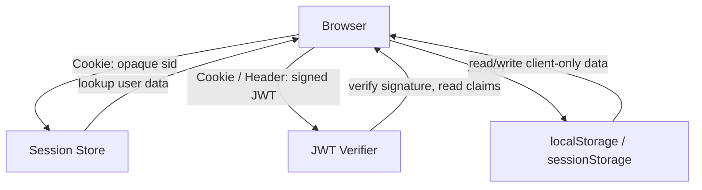

# 🧠 Topic: State Management Techniques

> [!abstract] Executive Summary (ELI5)
> Because HTTP has no memory, web apps bolt on four storage tools to remember a user: **cookies** (a tiny label the browser sends on every request), **server-side sessions** (a label pointing to a server-side filing cabinet), **JWTs** (a self-contained signed badge that needs no filing cabinet), and **`localStorage`/`sessionStorage`** (a drawer in the browser itself). Which one you pick depends on what you're storing, how sensitive it is, and how big your system needs to scale.

---

## 🎯 The "Why"
- **Problem Solved:** Maintain state — identity, cart, preferences, multi-step flows — across stateless HTTP requests (see [[HTTP_Statelessness]]).
- **Alternatives:** Each technique is the alternative to the others; the real decision is *where* state lives (client vs server) and *what shape* it takes (opaque ID vs self-contained token vs raw data).
- **Trade-offs:** Server-held state is more secure and easy to revoke, but harder to scale. Client-held state scales for free but can be read, stolen, or tampered with and is hard to invalidate.

## 💡 Mental Model & Analogy
- **Analogy:** "Cookies are a name tag the browser automatically pins to every request. Server-side sessions are a coat-check ticket — the ticket is worthless, all the real data is behind the counter. A JWT is a notarized ID card: it carries its own claims and a signature, so anyone can verify it without calling head office."
- **Visual/Diagram:**

## 🛠️ Core Principles

### The Four Techniques

#### 1. Cookies
- Small key/value strings stored in the browser and automatically attached to matching HTTP requests.
- Max size ~4 KB per domain. Sent on **every** same-origin request by default (including images, XHR, fetch) — a performance and security consideration.
- Common roles: carry a **session ID**, a **CSRF token**, a **refresh token**, or UI preferences (theme, locale).
- Always set security attributes — see [[Session_Security]].

#### 2. Server-Side Session Storage
- The server stores session data (user ID, roles, cart) in memory, a DB, or a cache like Redis.
- It sends the client only an **opaque session ID** (e.g. `sid=7f3a9b…`) inside a cookie.
- On each request the server looks up that ID to recover the data. See [[Session_Based_Authentication]].

#### 3. JWT (JSON Web Token)
- A self-contained token (Base64URL-encoded `header.payload.signature`) that **carries claims inside it** and is cryptographically signed.
- The server can verify it offline (just a signature check + secret/public key) without any DB/cache lookup.
- Ideal for cross-service and API auth; harder to revoke before expiry. See [[Token_Based_Authentication]].

#### 4. `localStorage` / `sessionStorage`
- Browser-side key/value stores accessible from JavaScript (the Web Storage API).
  - `localStorage` — persists across tabs and browser restarts until explicitly cleared.
  - `sessionStorage` — scoped to one tab, cleared when the tab closes.
- **Larger than cookies** (~5–10 MB), but **not sent automatically** — JS must read and attach the value (e.g. `Authorization: Bearer …`).
- **Security caveat:** storing tokens here exposes them to any XSS on the page. Prefer HttpOnly cookies for sensitive values when possible.

### Comparison Matrix

| Technique | Where data lives | Sent automatically? | Size limit | Revocable? | Typical use |
|---|---|---|---|---|---|
| **Cookies** | Client (browser) | ✅ on matching requests | ~4 KB | Only if points to server state | Session ID, CSRF token, preferences |
| **Server-side session** | Server (memory/Redis/DB) | n/a (only ID travels) | Unlimited | ✅ delete server-side | Traditional web login |
| **JWT** | Client (self-contained) | Manual (`Authorization` header) | ~8 KB practical | ❌ hard before expiry | APIs, microservices, OAuth |
| **localStorage / sessionStorage** | Client (browser JS) | ❌ manual | ~5–10 MB | ❌ | Non-sensitive UI state, SPA app state |

### Layering — They're Not Mutually Exclusive
Real systems combine them. A common modern pattern:
- JWT **access token** in an `Authorization` header for API calls.
- Longer-lived **refresh token** in an HttpOnly, Secure, SameSite cookie.
- UI state (selected theme, collapsed sidebar) in `localStorage`.

## ⚠️ Pitfalls & Anti-patterns
- **Storing real session data inside a plain cookie:** users can read and edit it. If you must, sign and encrypt.
- **Putting JWTs in `localStorage` without considering XSS:** a single stored XSS steals every user token. For high-security apps, prefer an HttpOnly cookie.
- **Forgetting `Secure` / `HttpOnly` / `SameSite`** on any sensitive cookie — covered in [[Session_Security]].
- **Overusing `localStorage` for everything:** it's synchronous, blocks the main thread, and survives forever — bad for sensitive or large data.
- **Choosing JWT just because it's trendy:** if you need instant revocation, server-side sessions are usually a better fit.

## 🔗 Deep Connections
- **Parent Topic:** [[01_Web_Sessions]]
- **Related Concepts:** [[HTTP_Statelessness]], [[Session_Based_Authentication]], [[Token_Based_Authentication]], [[Session_Security]]
- **Prerequisites:** HTTP request/response cycle, same-origin policy.

## ❓ Active Recall Questions

> [!faq]- How do web applications maintain state despite HTTP being stateless? *(PDF Q2)*
> Through four layered techniques: (1) **cookies** — small browser key/value pairs, often holding a session ID; (2) **server-side session storage** — the server stores session data linked to a session ID stored in the client's cookie; (3) **JWT** — a self-contained, signed token that carries claims and can be verified without server-side storage; (4) **`localStorage` / `sessionStorage`** — browser-side stores for client-only persistence.

> [!faq]- When would you reach for `localStorage` over a cookie?
> For non-sensitive, client-only UI state (theme, locale, draft form data) that JavaScript needs to read on every page load, or values larger than the ~4 KB cookie limit. Cookies win when the value must travel with every request automatically or must be hidden from JS (HttpOnly).

> [!faq]- What's the security trade-off between server-side sessions and JWT?
> Server-side sessions are more secure and instantly revocable — the sensitive data never leaves the server, and deleting the session ID kills access at once. JWTs are stateless and scalable, but cannot be trivially revoked before they expire, because validity lives in the token itself.

> [!faq]- Why is storing a JWT in `localStorage` risky?
> Any XSS on the page can read `localStorage` and exfiltrate the token. Cookies marked `HttpOnly` are invisible to JS, which removes that attack surface (but introduces CSRF, mitigated with `SameSite`).

---

*Last updated: 2026-07-18*
