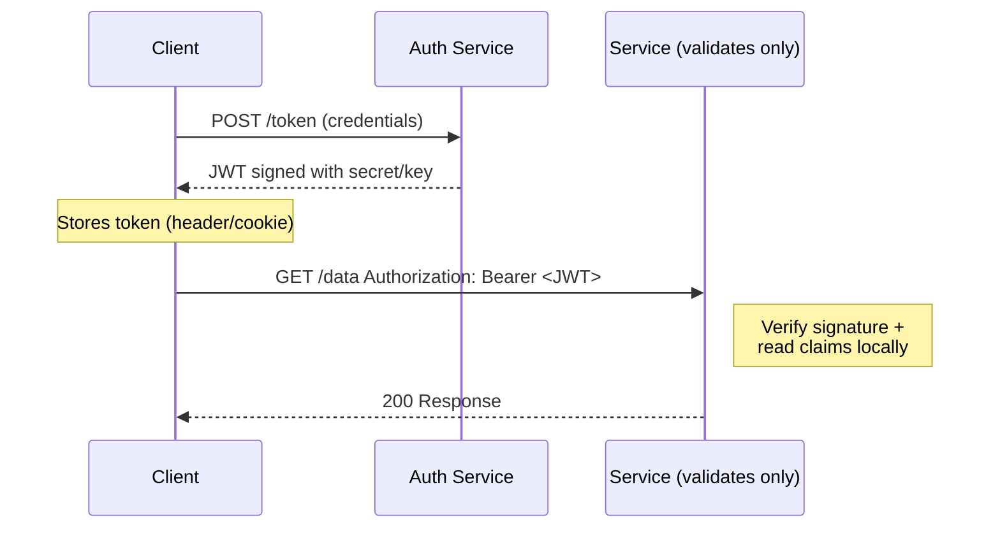

# 🧠 Topic: Token-Based Authentication (JWT)

> [!abstract] Executive Summary (ELI5)
> Instead of the server keeping a record of who you are, it hands you a **signed, self-contained ID badge** (a JWT). The badge itself states who you are, what you can do, and when it expires — plus a signature so anyone can verify it's genuine. Any service can check the badge without calling the login server. You trade instant revocation and zero server-side storage for effortless horizontal scaling across many services.

---

## 🎯 The "Why"
- **Problem Solved:** Authenticate a user across many servers or services without each one having to look up a central session store.
- **Alternatives:** Server-side session cookies (see [[Session_Based_Authentication]]) — central, secure, revocable, but stateful.
- **Trade-offs:** JWTs are stateless, portable, and scale beautifully, but cannot be trivially revoked before expiry and require disciplined handling to avoid security pitfalls.

## 💡 Mental Model & Analogy
- **Analogy:** "A JWT is a notarized festival wristband. It has your name, your access tier, and an expiry date printed on it, plus a tamper-evident stamp from the box office. Any checkpoint can verify the stamp with the box office's public signature — no phone call needed. But once stamped, the box office can't remotely invalidate your wristband before the printed expiry; they can only refuse to renew it."
- **Visual/Diagram:**

## 🛠️ Core Principles

### Anatomy of a JWT
A JWT is three Base64URL segments joined by dots: `header.payload.signature`.

| Segment | Contents | Example |
|---|---|---|
| **Header** | Token type + signing algorithm | `{"alg":"HS256","typ":"JWT"}` |
| **Payload** | **Claims** — statements about the subject. Standard claims: `sub` (subject), `iss` (issuer), `exp` (expiry), `iat` (issued-at), `aud` (audience). | `{"sub":"42","role":"admin","exp":1735689600}` |
| **Signature** | Cryptographic signature over `header.payload` using a secret (HMAC) or a private key (RSA/ECDSA). Verifiable by anyone with the secret/public key. | `HMAC-SHA256(base64(header)+"."+base64(payload), secret)` |

**Signing ≠ encrypting.** Anyone can read a standard JWT's payload (it's just Base64). Signatures guarantee *integrity* (untampered), not *confidentiality*. For secret payloads use JWE (encrypted JWTs).

### How Token-Based Auth Works
1. **Authentication:** Client sends credentials to an auth service (login server, OAuth provider).
2. **Issuance:** Auth service verifies credentials and issues a signed JWT containing claims (user ID, roles, expiry).
3. **Storage & transmission:** Client stores the token (memory, `localStorage`, or — better for XSS resistance — an HttpOnly cookie) and sends it on every request, typically via `Authorization: Bearer <token>`.
4. **Validation:** Each receiving service verifies the signature and checks `exp`/`iss`/`aud` **locally** — no DB or session-store lookup needed.
5. **Expiry & refresh:** Short-lived access tokens are paired with longer-lived **refresh tokens**; the client silently exchanges the refresh token for a new access token.

### JWT vs Server-Side Sessions — When to Pick Which *(PDF Q3 + Q4)*

JWT-based authentication is preferred when:
- You need a **stateless** authentication mechanism for scalability (e.g. microservices, public APIs).
- You want to avoid server-side session storage to reduce operational complexity.
- You need a token that can be used across **multiple services** (e.g. OAuth-style flows, SSO).

JWTs should **not** be used when:
- You need **session invalidation or revocation** — once issued, a JWT is valid until it expires unless you maintain a server-side blocklist (which defeats the statelessness).
- You can't keep token lifetimes short — long-lived JWTs are a security liability if stolen.

| Feature | Server-Side Sessions | Client-Side Tokens (JWT) |
|---|---|---|
| **Storage** | Server | Client |
| **Scalability** | Harder — needs shared/replicated store | Easier — stateless verification |
| **Security** | More secure; data never leaves server | Token can be stolen if not protected |
| **Performance** | Lookup overhead per request | No DB lookup; just signature check |
| **Revocation** | Delete server record → instant | Hard before expiry (needs blocklist) |
| **Use case** | Traditional server-rendered web apps | Microservices, APIs, OAuth, SSO |

### Access Tokens vs Refresh Tokens
- **Access token:** short-lived (5–15 min). Sent with every API call. If stolen, the damage window is small.
- **Refresh token:** long-lived (days/weeks). Used **only** to mint new access tokens. Stored more carefully (HttpOnly cookie) and usually single-use with rotation.
- This split gives you "JWT scalability" plus a usable story for logout (revoke the refresh token) without needing to blocklist every access token.

### Where OAuth and OpenID Connect Fit
- **OAuth 2.0** is an *authorization* framework — it lets a user grant a third party scoped access without sharing their password.
- **OpenID Connect (OIDC)** layers *authentication* on top of OAuth 2.0 and issues an **ID Token** (a JWT) representing the authenticated user.
- In a microservice setup, a central IdP (Identity Provider) issues JWTs; every service validates them locally — see [[Scaling_Session_Management]] Q11.

## ⚠️ Pitfalls & Anti-patterns
- **Long-lived access tokens with no revocation path:** the most common JWT mistake. Keep access tokens short; use refresh tokens.
- **Storing JWTs in `localStorage` and ignoring XSS:** any stored XSS exfiltrates every token. For sensitive apps, prefer an HttpOnly cookie.
- **Accepting `alg: none`:** your validator must reject unsigned tokens and pin an allow-list of algorithms, or an attacker can forge tokens.
- **Putting sensitive data in the payload:** payloads are not encrypted. Treat a standard JWT like a postcard, not a sealed letter.
- **Forgetting to validate `exp`, `iss`, `aud`:** a correctly signed token from the wrong issuer or audience is still a vulnerability.
- **Using JWT as a session replacement for a single traditional web app:** server-side sessions are usually simpler and safer there.

## 🔗 Deep Connections
- **Parent Topic:** [[01_Web_Sessions]]
- **Related Concepts:** [[Session_Based_Authentication]], [[State_Management_Techniques]], [[Session_Security]], [[Scaling_Session_Management]]
- **Prerequisites:** HMAC / asymmetric signatures, HTTP headers.

## ❓ Active Recall Questions

> [!faq]- When would you use JWT-based authentication instead of session-based authentication? *(PDF Q4)*
> When you need (1) a **stateless** mechanism for scalability (microservices, public APIs), (2) to avoid server-side session storage and its operational complexity, or (3) a token that's reusable **across multiple services** (OAuth, SSO). Avoid JWTs when you need easy **revocation** — they can't be deleted from the client once issued and are hard to invalidate before expiry.

> [!faq]- What are the differences between server-side sessions and client-side tokens? *(PDF Q3)*
> **Storage:** sessions on the server, tokens on the client. **Scalability:** sessions harder (need shared/replicated store), tokens easier (stateless). **Security:** sessions more secure (data never leaves server); tokens can be stolen if not protected. **Performance:** sessions have per-request lookup; tokens need only signature verification. **Use case:** sessions for traditional web apps; tokens for microservices/APIs.

> [!faq]- Why pair a short-lived access token with a longer-lived refresh token?
> Short access tokens (5–15 min) limit the blast radius if one is stolen; the refresh token is used only to mint new access tokens and is stored more carefully (HttpOnly cookie), can be rotated, and gives you a revocation hook (revoke the refresh) without maintaining a blocklist of every access token.

> [!faq]- What's the danger of `alg: none` in JWT?
> It declares the token unsigned. If your validator accepts it, anyone can forge a valid-looking token. Pin the algorithm(s) you actually use and reject unsigned tokens.

> [!faq]- Is a JWT encrypted? Can the user read its contents?
> No — by default a JWT is only *signed*, not encrypted. The payload is Base64URL, readable by anyone who intercepts it. Use JWE (encrypted JWT) if confidentiality is required, or keep sensitive data out of the payload.

---

*Last updated: 2026-07-18*
